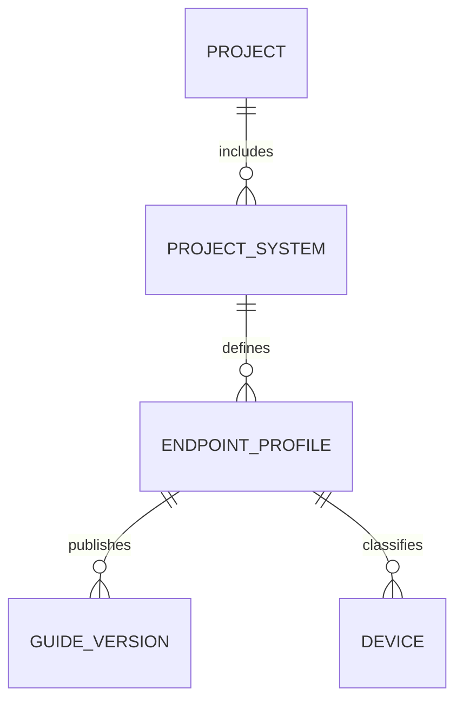
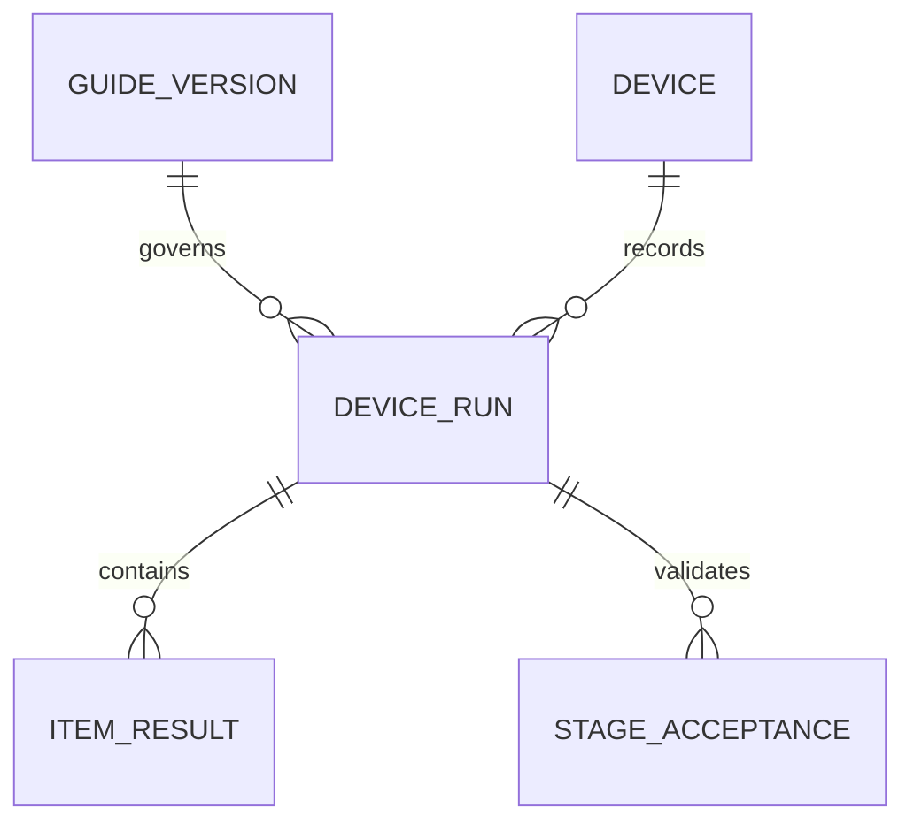
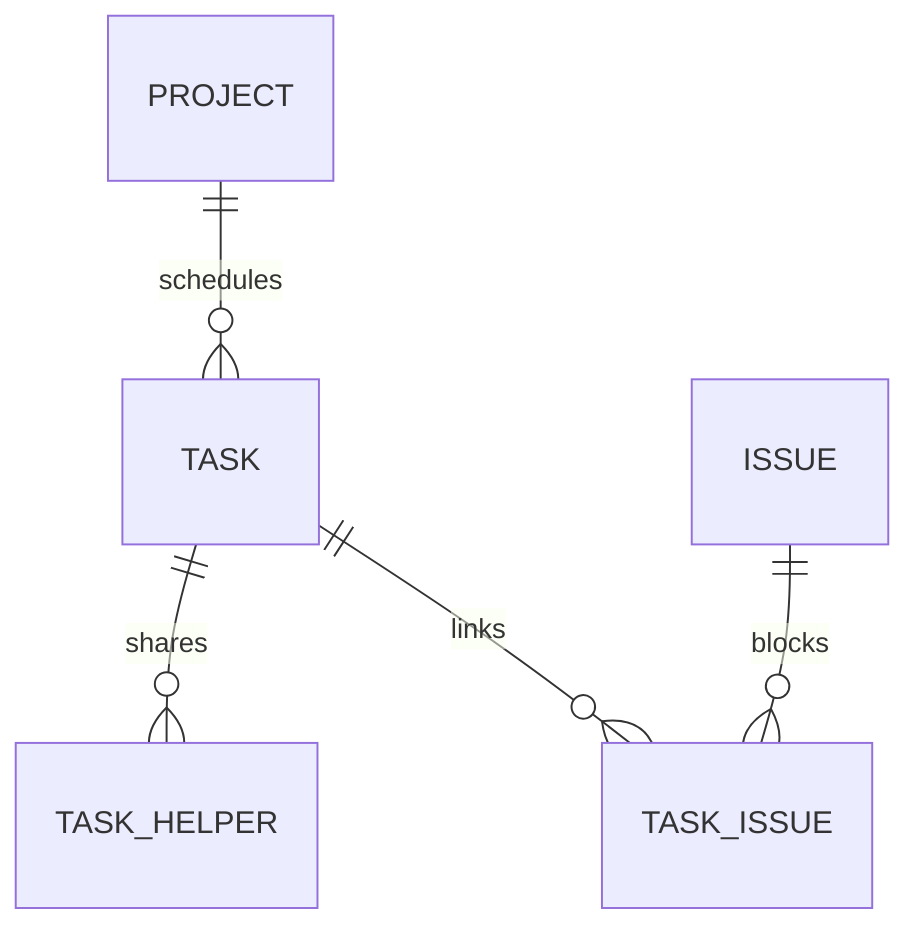

# NBDT — единая спецификация сайта

Версия: 1.1 · Дата: 21 октября 2026 года · Язык интерфейса: английский · Язык спецификации: русский.

**Дополнение 1.1:** раздел 23 содержит корректировки существующей реализации по семи новым скриншотам. Если сайт уже создан, начать с раздела 23: доработать имеющийся проект, сохранив его данные и работающие функции. Разделы 0–22 остаются общей спецификацией.

Назначение документа: дать разработчику или ИИ одно согласованное задание на реализацию внутреннего сайта NBDT для управления работами, техническими руководствами и готовностью систем проекта Legend of the Seas. Документ содержит описание пяти предоставленных экранов, единую систему оформления, правила работы с данными, адаптивность, рекомендуемую архитектуру и проверяемые критерии приёмки.

Карта документа: разделы 1–2 — исходники и устранение противоречий; 3–5 — навигация, дизайн и адаптивность; 6–10 — каждый из пяти экранов; 11–15 — архитектура, данные, API и права; 16–19 — реализация и приёмка; 20 — короткое вводное задание для ИИ; 21–22 — источники и границы допустимых допущений; 23 — конкретный план исправления уже созданного сайта по новым изображениям.

Это спецификация, а не утверждение о том, что сайт уже реализован или протестирован. Макеты показывают внешний вид и отдельные состояния, но не раскрывают все бизнес-правила. Ниже эти пробелы закрыты явными проектными решениями. Они должны применяться последовательно, пока заказчик явно не изменит соответствующее правило. Никакой документ не гарантирует отсутствие ошибок; обязательные сценарии проверки в конце позволяют обнаруживать их до передачи результата.

## 0. Инструкция для ИИ-исполнителя

1. Реализуй целое приложение с общими компонентами и одной моделью данных. Пять изображений — связанные состояния одного продукта, а не пять независимых лендингов.
2. Следуй нормативным правилам этого документа. При конфликте с изображением применяй раздел 2: в макетах есть демонстрационные противоречия.
3. Не превращай приложение в картинку. Таблицы, фильтры, панели, формы, чекбоксы, переходы и счётчики должны работать.
4. Не подменяй сохранение данных уведомлением об успехе. Успех показывается после подтверждённой записи; ошибка должна сохранять введённые данные.
5. Не выдумывай реальные VLAN, IP-диапазоны, учётные записи, адреса SharePoint, состав команды или корпоративную инфраструктуру. Значения из макетов с пометкой Example являются демонстрационными.
6. Сначала создай общие токены, оболочку, типы данных и правила вычислений, затем экраны. Не копируй стили между страницами.
7. Сохрани композицию: тёмно-синяя левая навигация, светлая рабочая область, белые панели, синие действия, компактные технические сведения и удобные чек-листы.
8. Проверяй весь диапазон ширин, а не только несколько популярных устройств. При недостатке места меняй композицию; не уменьшай весь сайт через `transform: scale()` или `zoom`.
9. Не включай в интерфейс пояснения об устройстве кода, API, моках или библиотеке компонентов. Демонстрационный набор обозначается одним понятным баннером `Demo data`.
10. Не объявляй работу завершённой, пока не выполнены критерии раздела 19. Нереализованные интеграции называй явно; не имитируй настоящую синхронизацию.
11. Для существующего проекта сначала выполни аудит и корректировки раздела 23. Не начинай новый проект, не сбрасывай БД и не заменяй реальные записи примерами из макетов ради внешнего сходства.

Термины нормативности: **ОБЯЗАТЕЛЬНО** — требование реализации; **ЗАПРЕЩЕНО** — недопустимое поведение; **РЕКОМЕНДУЕТСЯ** — предложенный способ исполнения, который можно заменить эквивалентным без изменения поведения.

## 1. Исходные экраны и их назначение

Все пять исходных PNG имеют размер 1672 × 941 пиксель. Это размер контрольного изображения, а не фиксированная ширина сайта. На настоящем экране используются CSS-пиксели и естественная прокрутка.

| ID | Исходный файл | Что изображено | Роль в приложении |
|---|---|---|---|
| S1 | `Week 36 assignment tracker dashboard(2).png` | Неделя 36, список задач по сотрудникам, справа назначения Homesh | Детальная недельная работа команды |
| S2 | `Legend of the Seas weekly tracker(2).png` | Матрица сотрудников и четырёх недель W36–W39 | Планирование и обзор загрузки |
| S3 | `NBDT System Registry Guide Library(2).png` | Реестр систем, шесть карточек, поиск, фильтры и пагинация | Каталог руководств и технических профилей |
| S4 | `Premium blue configuration report dashboard(2).png` | Четыре KPI и таблица готовности систем | Сводный контроль конфигурации и развёртывания |
| S5 | `Streamlined POS configuration checklist(2).png` | Руководство POS — Mobility, Technical essentials, Lessons Learned и три этапа | Выполнение работ по конкретному устройству |

Рабочая последовательность пользователя: увидеть план в S2 → открыть назначения человека или неделю в S1 → открыть связанную систему в S3 → выполнить работу по устройству в S5 → увидеть обновлённые показатели в S4. Из S4 также можно сразу перейти к устройствам и руководству нужной системы.

## 2. Разрешение противоречий макетов

Эта таблица имеет приоритет перед буквальным копированием изображения.

| Наблюдение | Нормативное решение |
|---|---|
| В разных файлах активный пункт меню синий, бирюзовый или серо-синий | Единственный основной цвет действия — `--brand`; навигация активна синим на всех страницах |
| Active в S1 зелёный, а в S2 синий; Planned тоже меняет цвет | Active — синий, Planned — серо-синий, Done — зелёный, Blocked — янтарный; одни токены на всём сайте |
| S3 и S5 показывают 72 системы, S4 — 74 | Количество берётся из одного набора ProjectSystem. Одинаковая область данных даёт одинаковое число; разные фильтры объясняются подписью |
| Внизу S2 встречаются W54–W61 | Использовать ISO-недели с ISO-годом. После последней недели года начинается W01 следующего ISO-года. W54 не существует |
| Terminal testing у Jorge Active, а помощь Homesh в этой же задаче Planned | В базовой версии задача имеет один общий статус. Обе строки показывают Active; роль Homesh — Helper. Независимый статус вклада помощника в базовый объём не входит |
| Поэтому сводка Homesh на S1 показывает 2 active / 3 planned | Для перечисленных семи задач после унификации получится 3 active / 2 planned / 1 done / 1 blocked. Счётчик вычисляется, а не копируется текстом |
| POS — Mobility в карточке и руководстве — Windows workstation; в отчёте — Zebra Android | Предусмотреть EndpointProfile. В пределах одного выбранного профиля сведения обязаны совпадать. Несколько реальных профилей допускаются только как отдельные связанные записи; не создавать их автоматически из противоречия картинки |
| QControl в реестре — PC/Windows, в отчёте — iPad | То же правило EndpointProfile; единственный выбранный профиль не может одновременно быть Windows PC и iPad |
| S5 показывает Owner Jorge, отчёт для POS — Apple | Разделить Technical owner руководства и Deployment owner системы. В форме, подсказках и модели явно указать область ответственности |
| В S4 у POS — Mobility Ready 194 больше Base 187; у Emustering Deployed 109 больше Base/Ready 55 | В подтверждённых данных действует `deployed ≤ ready ≤ base ≤ qty`. Такие строки нельзя импортировать как действующие без исправления |
| MOB/POS/QCO в колонке Venue выглядят как коды систем | Код хранить отдельно. Venue означает физическую площадку/зону. Не выдавать код системы за место установки |
| AW не расшифрован | Проектное допущение: AirWatch / MDM. В интерфейсе подпись `MDM` и tooltip `AirWatch / MDM requirement`; при необходимости название меняется конфигурацией проекта |
| VLAN 230, 340, IP scope и service account выглядят как настоящие параметры | Для показанного демонстрационного контекста хранить `valueState: example`; показывать `Example`. Не использовать их для реальной конфигурации автоматически |
| Рисунок содержит корону/якорь, разные названия бренда, декоративный корабль | По умолчанию единый текстовый бренд NBDT. Официальный логотип подключается предоставленным SVG; не рисовать его заново и не использовать случайную эмблему |
| Overview, Issues, List и формы добавления полностью не показаны | Их согласованное минимальное поведение задано ниже как предлагаемая реализация; не представлять это как увиденный на изображении интерфейс |

### 2.1. Принятые настройки первой версии

- Название продукта: `NBDT`.
- Текущий проект в примерах: `Legend of the Seas`.
- Интерфейс: английский; все строки вынести в словарь для будущего перевода.
- Оформление: одна светлая тема с тёмной навигацией. Отдельную тёмную тему не создавать в первой версии.
- Начало недели: понедельник. Пример для визуальной сверки: W36 2026, 31 Aug – 6 Sep 2026.
- Основные стадии: Base Configuration → Ready for Deployment → Deployment.
- Preparation — дополнительный нулевой блок только у профилей, которым он нужен, изначально свёрнутый.
- Cyber approval — отдельный процесс согласования, не четвёртая стадия чек-листа.
- У каждой задачи ровно один Owner и любое число Helper; участник не может дважды входить в одну задачу.
- Все количественные примеры макетов — образцы представления. Производственные показатели всегда вычисляются из фактических записей.

## 3. Информационная архитектура и навигация

### 3.1. Общие разделы

Слева всегда один и тот же порядок: `Overview`, `Weekly Tracker`, `Systems`, `Issues`, `Configuration Report`. Убирать Overview только на части страниц или переименовывать Issues в Issue Tracker на одном экране запрещено. На узких экранах эти же пункты находятся в навигационной панели, открываемой кнопкой меню.

| Маршрут | Содержание | Активная навигация |
|---|---|---|
| `/projects/:projectId/overview` | Сводка проекта, переходы к блокерам и текущей неделе | Overview |
| `/projects/:projectId/tracker?view=overview&week=2026-W36&span=4` | S2 | Weekly Tracker |
| `/projects/:projectId/tracker?view=week&week=2026-W36` | S1 | Weekly Tracker |
| `/projects/:projectId/tracker?view=list&week=2026-W36&span=4` | Плоский список за выбранный период | Weekly Tracker |
| `/projects/:projectId/systems` | S3 | Systems |
| `/projects/:projectId/systems/:systemId/guide?profile=:profileId&device=:deviceId&stage=base` | S5 | Systems |
| `/projects/:projectId/reports/configuration` | S4 | Configuration Report |
| `/projects/:projectId/issues` | Реестр блокеров и других проблем | Issues |

Фильтры, сортировка, страница, неделя, выбранный сотрудник и открытая задача сериализуются в URL. Пример: `.../tracker?view=week&week=2026-W36&person=homesh&task=terminal-testing`. Названия в примере читаемые; в реальном приложении используются устойчивые ID, а не отображаемые имена. URL открывается напрямую и восстанавливает состояние после обновления страницы. Неизвестный ID даёт корректный экран Not found, а не исключение JavaScript.

Смена проекта сохраняет только совместимые настройки отображения, но очищает ссылки на сотрудников, задачи, устройства и фильтры предыдущего проекта. Сначала проверить доступ пользователя к новому проекту. Нельзя показывать прежние данные под заголовком нового проекта во время загрузки.

### 3.2. Глобальный Overview — предлагаемое дополнение

Это отдельная страница, не вкладка Overview внутри Weekly Tracker. Показать название проекта, текущую неделю, количество уникальных задач за неделю, количество блокированных задач, количество устройств и три процента готовности. Далее — две компактные секции: `My assignments` и `Open blockers`, по пять записей с `View all`. Использовать те же вычисления и карточки, что в основных разделах. Собственный параллельный механизм подсчёта запрещён.

### 3.3. Issues — предлагаемое дополнение

Таблица/карточки: Title, Severity, Status, Related system/device/task, Owner, Updated. Статусы проблемы: Open, In progress, Resolved. Severity: Informational, Warning, Critical. Проблема может быть связана с несколькими задачами; блокировка задачи указывается явной связью `blocksTask=true`. Закрытие проблемы не завершает задачу: оно снимает соответствующую причину блокировки. Пока остаётся хотя бы один открытый блокирующий Issue, задача не может выйти из Blocked. Не использовать слово Issue как синоним каждой заметки Lessons Learned.

## 4. Единая визуальная система

### 4.1. Характер оформления

Корпоративный рабочий интерфейс: ясная иерархия, умеренная плотность, спокойный светло-голубой фон, тонкие границы, тёмно-синие заголовки. Основное внимание уделяется содержимому, статусам и следующим действиям. Отказаться от стеклянных панелей, сильного blur, неонового свечения, разноцветных декоративных градиентов, объёмных иконок и случайных теней.

Верх страницы и карточки визуально легче левой навигации. Насыщенный синий используется точечно: активное меню, главное действие, выбранный этап, интерактивные ссылки. Янтарный фон предназначен для предупреждений и блокировки, а не для обычного выделения строки.

### 4.2. Цветовые токены — обязательные значения

Все значения объявить один раз. Локальные HEX в компонентах запрещены, кроме настоящего изображения/логотипа и автоматически сгенерированных аватаров, использующих заданную палитру.

```css
:root {
  color-scheme: light;
  --nav-top: #06264B;
  --nav-bottom: #041B34;
  --nav-text: #FFFFFF;
  --nav-muted: #B6CAE3;
  --nav-hover: #12385F;

  --brand: #0066F5;
  --brand-hover: #0053CC;
  --brand-pressed: #0045AA;
  --brand-soft: #E8F1FF;
  --brand-border: #92BFFF;

  --page-bg: #F3F8FE;
  --surface: #FFFFFF;
  --surface-subtle: #F8FBFF;
  --table-head: #EDF3FA;
  --row-hover: #F2F7FF;
  --text-heading: #081C4A;
  --text-body: #20385C;
  --text-secondary: #5C6F8E;
  --text-placeholder: #65758B;
  --border: #D9E5F3;
  --control-border: #7C8FAB;

  --active-text: #075CCB;
  --active-bg: #E8F1FF;
  --planned-text: #52627A;
  --planned-bg: #F0F4F8;
  --done-text: #166534;
  --done-bg: #E9F7EE;
  --blocked-text: #924600;
  --blocked-bg: #FFF4DD;
  --blocked-border: #E6B75D;

  --danger-text: #B42318;
  --danger-bg: #FFF0EE;
  --focus: #005FCC;
  --disabled-bg: #EDF1F6;
  --disabled-text: #5C6B80;

  --phase-base: #0066F5;
  --phase-ready: #6256DC;
  --phase-deployed: #008CA6;
  --phase-cyber: #00857F;
  --progress-track: #E3EBF5;

  --radius-control: 8px;
  --radius-card: 12px;
  --radius-panel: 16px;
  --radius-badge: 6px;
  --shadow-card: 0 2px 8px rgb(8 28 74 / 4%);
  --shadow-overlay: 0 12px 40px rgb(8 28 74 / 18%);
  --space-1: 4px;
  --space-2: 8px;
  --space-3: 12px;
  --space-4: 16px;
  --space-5: 20px;
  --space-6: 24px;
  --space-8: 32px;
  --space-10: 40px;
  --sidebar-full: 240px;
  --sidebar-rail: 72px;
  --content-max: 1920px;
}
```

Светлая граница `--border` разделяет контейнеры, но не должна быть единственным признаком интерактивности. У полей ввода и чекбоксов используется более заметный `--control-border`; у кнопок с обводкой — синий border. Для маленького текста запрещено использовать цвета полос прогресса Ready/Deployment: подписи остаются тёмными.

### 4.3. Статусы

| Состояние | Текст | Фон | Представление |
|---|---|---|---|
| Planned | planned-text | planned-bg | Текст Planned, при необходимости точка/значок календаря |
| Active | active-text | active-bg | Текст Active; не применять зелёный |
| Done | done-text | done-bg | Текст Done и маленькая галочка |
| Blocked | blocked-text | blocked-bg | Текст Blocked, значок предупреждения и доступная причина |
| Cyber In review | blocked-text | blocked-bg | Текст In review |
| Cyber Approved | done-text | done-bg | Текст Approved с галочкой; бирюзовый допустим только у отдельного KPI Cyber |
| Cyber Rejected | danger-text | danger-bg | Текст Rejected и причина |
| Not applicable | text-secondary | прозрачный | Текст N/A с расшифровкой |
| Unknown / To confirm | text-secondary | surface-subtle | Понятная надпись, без зелёной галочки |

В плотной матрице S2 разрешён текст статуса без плашки, но семантический цвет остаётся тем же. Цвет никогда не является единственным носителем смысла. Состояния Selected, Hover, Keyboard focus и Blocked визуально различаются.

### 4.4. Типографика

Основной шрифт: `Inter`, если его файл включён в проект; иначе `"Segoe UI", system-ui, -apple-system, sans-serif`. Не ставить внешнюю загрузку шрифта обязательным условием отображения. Один шрифт на всём сайте; межбуквенный интервал нормальный, у больших заголовков допускается `-0.02em`.

| Роль | Размер / line-height | Weight |
|---|---|---|
| Название страницы | `clamp(24px, 1.6vw + 12px, 34px)` / 1.2 | 700 |
| Заголовок раздела | 22px / 28px; на телефоне 20px / 26px | 700 |
| Название системы в карточке | 20px / 26px | 650–700 |
| Заголовок карточки задачи | 16px / 22px | 600 |
| Основной текст, поля, таблицы | 14px / 20px | 400 |
| Текст пункта чек-листа | 15px / 22px | 400 |
| Метаданные и вспомогательный текст | 13px / 18px | 400 |
| KPI | 36px / 42px; на телефоне 30px / 36px | 700 |
| Кнопки и активная навигация | 14px / 20px | 600 |

Цифры таблиц и счётчиков: `font-variant-numeric: tabular-nums`. Не делать весь чек-лист жирным. Не опускаться ниже 12px для второстепенной подписи; основные задачи, поля и значения не меньше 14px. Заголовок не должен становиться микроскопическим ради размещения в одну строку.

### 4.5. Кнопки, поля, иконки

- Primary: синий фон, белый текст, минимум 44px по высоте, padding 10px 16px, radius 8px; слева значок 18–20px, gap 8px. На странице одна группа главного действия; две соседние primary допустимы только для разных контекстов, например Documentation и Continue внутри руководства.
- Secondary: белый фон, синяя обводка, синий текст. Quiet: прозрачный фон, тёмный/синий текст, заметный hover. Destructive: отдельное опасное действие, не обычное закрытие панели.
- Иконка без текста: реальная зона нажатия 44 × 44px, даже если рисунок 20px. У каждой кнопки есть понятное accessible name.
- Поле/селект: высота не меньше 44px, padding 12px, label вне placeholder. Placeholder — пример, а не единственное имя поля. В поиске слева лупа, справа Clear при непустом значении.
- Badge: высота от 24px, padding 3px 9px, radius 6px, текст 13px/18px; не кнопка, если не выполняет действие.
- Иконки: один outline-набор, единая толщина 1.75–2px. Sidebar 22px; действия 18–20px; Technical essentials 24px внутри 32–36px светлой плитки.
- Семантические соответствия: Overview — home, Weekly Tracker — calendar, Systems — database, Issues — warning triangle, Configuration Report — bar chart; Endpoint — monitor/mobile, OS — window, Connection — plug/Wi-Fi, VLAN — network, IP scope — globe, IP reservation — lock, Service account — user-key, Domain/OU — hierarchy, MDM — shield-device, Naming — tag, Required applications — grid, Owner — user.
- Анимации интерфейса 120–180ms opacity/background/transform. Не анимировать цифры от нуля при каждом фильтре. Уважать `prefers-reduced-motion`.

### 4.6. Общая оболочка и интервалы

На ширине 1672px sidebar занимает 240px. Рабочая область — остальное; внутри padding 24px. Заголовок страницы и тулбар не должны прилипать к краям. Между крупными секциями 20–24px, между связанными элементами 8–12px. Сетка основана на шаге 4px.

Sidebar: тёмный вертикальный градиент от nav-top к nav-bottom; блок бренда, подпись Project, селектор проекта, разделитель, пункты меню. Пункт высотой 48px, внутренний отступ 16px, внешние поля 8px. Активный — синий фон, белый текст и тонкий светлый маркер слева. У всех экранов одинаковые размеры, иконки и порядок. Внизу можно показывать состояние соединения, но только на основании настоящей проверки; надпись Connected не является декоративной.

Карточки: белая поверхность, border 1px, radius 12px. Большая панель отчёта/руководства может иметь radius 16px. Не помещать каждую строку таблицы в отдельную теневую карточку на desktop.

Верхний заголовок: слева H1 и подзаголовок с проектом/периодом; справа действия. Если места мало, действия переносятся вниз отдельным рядом. Нельзя накладывать их на заголовок или обрезать название проекта без возможности прочитать целиком.

Рекомендуемый каркас:

```css
* { box-sizing: border-box; }
html { font-family: Inter, "Segoe UI", system-ui, sans-serif; }
body { margin: 0; color: var(--text-body); background: var(--page-bg); }
button, input, select, textarea { font: inherit; }
button, a, input, select, textarea { -webkit-tap-highlight-color: transparent; }
.app-shell { display: grid; grid-template-columns: var(--sidebar-full) minmax(0, 1fr); min-height: 100dvh; }
.sidebar { position: sticky; top: 0; height: 100dvh; overflow-y: auto; }
.workspace { min-width: 0; container: workspace / inline-size; }
.page { width: 100%; max-width: var(--content-max); margin-inline: auto; padding: 24px; }
.page-heading { display: flex; align-items: flex-start; justify-content: space-between; gap: 16px; flex-wrap: wrap; }
.page-heading > :first-child { min-width: 0; flex: 1 1 360px; }
.page-actions { display: flex; align-items: center; flex-wrap: wrap; gap: 12px; }
.card { border: 1px solid var(--border); border-radius: var(--radius-card); background: var(--surface); }
:focus-visible { outline: 3px solid var(--focus); outline-offset: 3px; }
.technical-value, .long-token { overflow-wrap: anywhere; }
@media (1024px <= width < 1280px) {
  .app-shell { grid-template-columns: var(--sidebar-rail) minmax(0, 1fr); }
}
@media (width < 1024px) {
  .app-shell { display: block; }
  .sidebar { display: none; } /* вместо неё отдельный доступный navigation drawer */
  .page { padding: 16px; }
}
@media (width < 600px) {
  .page { padding: 12px; }
  .page-heading > :first-child { flex-basis: 100%; }
  .page-actions { width: 100%; }
}
```

Это опорный CSS, а не готовая реализация всех экранов. При использовании utility-классов значения и поведение должны остаться теми же. Не задавать глобально `overflow-x: hidden`: это скрывает ошибки раскладки и может обрезать focus outline.

## 5. Адаптивность и общие правила компоновки

### 5.1. Два уровня адаптации

Media queries отвечают за оболочку: полная навигация / узкая панель / верхнее мобильное меню. Container queries отвечают за внутренние сетки, которые меняют ширину при открытии деталей. Ориентироваться только на ширину физического устройства недостаточно: открытая правая панель и масштаб браузера меняют доступное место.

| Ширина viewport в CSS px | Оболочка | Поведение |
|---|---|---|
| ≥ 1280 | Sidebar 240px | Полные названия разделов |
| 1024–1279 | Rail 72px | Иконки, tooltip при hover и focus, доступные имена; проект через popover |
| 600–1023 | Верхняя панель 64px, меню-drawer | Контент занимает всю ширину; таблицы локально прокручиваются |
| 320–599 | Верхняя панель 56–64px, меню-drawer | Одна колонка, фильтры в Filters, крупные touch-зоны |
| < 320 | Нестандартный случай | Содержимое остаётся доступным, без принудительного уменьшения шрифта; минимальная целевая ширина проверки 320px |

Реагировать также на высоту: при `height < 600px` тяжёлые sticky-панели и закреплённые нижние действия переходят в обычный поток. Открытые диалоги прокручиваются внутри доступной высоты, кнопка закрытия остаётся доступной. Учесть экранную клавиатуру и safe-area телефона.

### 5.2. Правила отдельных компонентов

| Компонент | Широкая область | Средняя область | Узкая область |
|---|---|---|---|
| Registry | 3 карточки при workspace ≥1080px | 2 при 700–1079px | 1 при <700px |
| KPI Report | 4 при workspace ≥1100px | 2 при 560–1099px | 1 при <560px |
| Technical essentials | 4 группы при внутренней ширине ≥1120px | 2 группы при 640–1119px | 1 группа при <640px |
| Week + person panel | Inline, когда внутренняя область ≥1120px | Overlay drawer | На viewport <600px полноэкранная панель |
| Чек-лист | Текст и подсказка в 2 колонках при ширине блока ≥880px | Подсказка под текстом | То же, без горизонтального скролла |
| Стадии | 3 равных связанных сегмента при ширине блока ≥720px | Вертикальные 3 строки | Вертикальные строки; все названия читаемы |
| Таблица отчёта | Все разрешённые колонки | Локальный горизонтальный скролл | Карточки систем по умолчанию; таблица доступна переключателем |
| Матрица недель | Person + 4 недели, min-width около 1180px | Локальный горизонтальный скролл | Режим By person с недельными карточками; матрица доступна явно |

Пороги указаны для конкретного контейнера. Например, `.guide-body` получает `container-type: inline-size`, а её дочерний `.essentials-grid` переключается по ширине guide-body. Не проверять размер элемента, чью собственную раскладку меняет этот же запрос.

### 5.3. Содержимое и прокрутка

- По умолчанию вертикально прокручивается страница. Не запирать всё приложение в `height: 941px`, `overflow: hidden` или отдельной внутренней прокрутке каждого блока.
- Исключения: модальный drawer/dialog, длинный список подсказок, горизонтальная область большой таблицы. У каждого скролл-контейнера есть понятное назначение.
- Никакой горизонтальной прокрутки всего документа на 320px. Для настоящей двумерной матрицы допустим локальный горизонтальный скролл внутри подписанного региона.
- На desktop имена и описания переносятся. Ellipsis допускается у превью задачи в матрице, если полное название доступно в панели и по focus/tooltip. Нельзя делать tooltip единственным способом узнать критически важный параметр на телефоне.
- Названия длиннее 80 символов, аккаунты, hostname и URL не должны растягивать Grid. Использовать `min-width: 0` и подходящий `overflow-wrap`.
- В landscape телефона не должно появляться две панели по 200px с нечитаемым текстом: overlay остаётся overlay.
- На 1920/2560/3840px контент не растягивается бесконечно. Основная область ограничена content-max и центрируется, sidebar остаётся слева. Не увеличивать число колонок реестра сверх трёх по умолчанию.
- Sticky header не должен перекрывать якоря, ошибки полей и фокус. Задать `scroll-margin-top`/`scroll-padding-bottom` соответственно реальной высоте закреплённых элементов.

### 5.4. Минимальные правила доступности

Цель — поведение, соответствующее применимым требованиям WCAG 2.2 AA; соответствие подтверждается проверкой, а не только использованием ARIA. Обычный текст должен иметь контраст не ниже 4.5:1, крупный — 3:1, существенные графические границы/состояния — 3:1. Основные действия продукта имеют touch-зону от 44 × 44px; это проектное требование, более крупное, чем базовый минимум 24px WCAG 2.2 с оговорёнными стандартом исключениями.

Все действия доступны клавиатурой. Использовать настоящие button, link, input, table и headings. Sidebar имеет `nav` и `aria-current="page"`; иконки рядом с текстом декоративны. У модального drawer фокус находится внутри, фон недоступен, Escape закрывает, фокус возвращается инициатору. У inline-панели нет modal focus trap. У accordion есть button, `aria-expanded` и `aria-controls`. У табличной сортировки используется `aria-sort`; у прогресса есть доступные числовые значения.

Для сегментов `Overview / Week / List`, которые меняют маршрут, предпочтительны ссылки с признаком текущего представления. Если реализованы настоящие вкладки с tablist, обязательно реализовать полную клавиатурную модель вкладок, включая стрелки, Home/End и согласованную активацию. Нельзя только проставить `role="tab"` обычным кнопкам и забыть поведение.

## 6. S1 — Weekly Tracker, подробная неделя

### 6.1. Состав экрана сверху вниз

1. Общий sidebar, активен Weekly Tracker.
2. Заголовок `NBDT Weekly Tracker — Week 36`; ниже `31 Aug – 6 Sep 2026 · Legend of the Seas`. Номер и даты динамические.
3. Справа: Previous week, выбор недели/года, Next week и primary `Add task` с плюсом. Стрелки меняют период на одну ISO-неделю и сохраняют применимые фильтры.
4. Тулбар: сегменты Overview / Week / List, выбран Week; `Group by: Person`; фильтр All statuses; поиск `Search tasks, people, or systems…`.
5. Основная область: слева `WEEK TASK LIST (GROUPED BY PERSON)` и сгруппированный список; справа при выборе — назначения человека на выбранную неделю.

На широком экране правая панель занимает 34–38% рабочей строки, но не меньше 360px и не больше 520px; левая часть не меньше 620px. Если эти ограничения одновременно невыполнимы, панель становится overlay, а список сохраняет полезную ширину. Использовать проверку контейнера от 1120px, а не пытаться уместить две части на любом desktop.

### 6.2. Тулбар и фильтрация

- `Group by` имеет значения Person, System, None. Person — исходное состояние S1. System группирует уникальные задачи, а не копии по помощникам. None показывает одну строку на задачу.
- All statuses: Planned, Active, Done, Blocked; можно выбрать несколько. Кнопка Clear filters сбрасывает поиск и фильтры, но сохраняет неделю и представление.
- Поиск ищет по названию/описанию задачи, имени Owner/Helper, названию и коду системы, имени связанного устройства. Регистронезависимый, с обрезкой внешних пробелов; debounce 250ms. На ввод поиска страница возвращается к началу результатов, но поле сохраняет фокус.
- Фильтры соединяются через AND; значения внутри одного мультиселекта — через OR.
- Счётчики групп и панели учитывают один и тот же набор фильтров. Подпись при активном фильтре: `Showing 4 of 7 assignments`, чтобы пользователь понимал разницу с общим количеством.
- По умолчанию видны все сотрудники выбранной команды, включая тех, у кого нет назначений; пустая группа компактна с текстом `No assignments`. При поиске/статус-фильтре группы без совпадений скрываются.

Team ограничивает видимых участников и их назначения, а не только Owner задачи: задача с Owner из другой команды остаётся видна в выбранной команде через её Helper. Глобальная сводка текущего scope берёт unique Task из видимых назначений. Поиск по имени любого участника сначала находит Task, затем показывает её подходящие назначения; поэтому поиск Jorge может также показать Homesh как Helper в Terminal testing. Это ожидаемое поведение, а не дублирование задачи.

### 6.3. Структура списка

Настоящая таблица с колонками Task, Role, Status, Due; для групп допустимы отдельные tbody. Заголовок Person оформляется отдельной групповой строкой: кнопка раскрытия, круглый аватар с первой буквой, имя, подпись `7 assignments · 1 blocked`. Указать `aria-expanded`. Кнопка раскрытия и ссылка открытия панели — разные доступные цели; если вся заголовочная полоса открывает панель, chevron должен обрабатывать событие отдельно.

Раскрыть/свернуть группу не равно выбрать человека. Возможны несколько раскрытых групп одновременно. Выбор Homesh открывает его панель и выделяет заголовок мягким brand-soft. Иконка X закрывает только панель, не сворачивает группы и не сбрасывает фильтры.

Пропорции без панели: Task 48%, Role 22%, Status 16%, Due 14%; с панелью ширины задаются minmax, а не жёсткими процентами. Task должен оставаться главным. Строка от 44px, заголовок группы 64–72px. Длинное название занимает две и более строки, высота увеличивается. Статус не накладывается на Due.

Role — отношение выбранного человека к задаче: `Owner` либо `Helping Jorge` с подписью/tooltip `Helper · Owner: Jorge`. Должность сотрудника в эту колонку не подставлять.

Сортировка по умолчанию внутри группы: Blocked → Active → Planned → Done, затем Due по возрастанию с отсутствующей датой в конце, затем title и ID. Если нужен точный порядок демонстрационного макета, разрешён отдельный fixture sortOrder; производственные правила сортировки остаются явными.

У Blocked-строки допустим очень светлый янтарный фон всей строки. У выбранной задачи — синий маркер/обводка, а не второй сплошной фон, скрывающий предупреждение. При одновременном Blocked и Selected сохранить оба признака.

### 6.4. Содержание показанного примера

| Человек | Задача | Роль в этой группе | Единый статус | Due/Completed |
|---|---|---|---|---|
| Homesh | VLAN configuration | Owner | Blocked | Due 3 Sep |
| Homesh | POS configuration | Owner | Active | Due 4 Sep |
| Homesh | ACP setup | Owner | Active | Due 4 Sep |
| Homesh | Terminal testing | Helping Jorge | Active, см. исправление S1/S2 | Due 4 Sep |
| Homesh | Device inventory | Owner | Done | Completed 1 Sep |
| Homesh | Printer checks | Owner | Planned | Due 4 Sep |
| Homesh | Handover notes | Owner | Planned | Due 6 Sep |
| Jorge | Network checks | Owner | Done | Completed 1 Sep |
| Jorge | Terminal testing | Owner | Active | Due 4 Sep |
| Jorge | Wi-Fi validation | Owner | Active | Due 4 Sep |
| Jorge | Port documentation | Owner | Planned | Due 6 Sep |
| Apple | Пять назначений | Состав раскрывается из данных | Среди них 1 Blocked | Не подставлять вымышленные реальные сроки |
| Ronny | Три назначения | Состав раскрывается из данных | Среди них 1 Blocked | То же |

Terminal testing в двух группах — одна Task с двумя Assignment, не два разных объекта. Два разных Device inventory у разных Owner могут быть разными задачами с одинаковым названием; объединять их по title запрещено.

### 6.5. Правая панель человека

Шапка: `Homesh · Week 36`, подзаголовок `All 7 assignments`, X. Следующая строка — рассчитанные значения `3 active · 2 planned · 1 done · 1 blocked` для согласованного примера. Не сортировать цветовую легенду случайным образом: Active, Planned, Done, Blocked везде одинаково.

Каждое назначение: название, badge статуса справа, метаданные `Network · Owner · Due 3 Sep`. Для помощника: `POS · Helper · Due 4 Sep`, отдельная строка `Owner: Jorge · Shared task, counted once`. Признак Shared появляется при двух и более участниках. У Done показывать Completed, а не просроченный Due как главный метатекст.

Блокированная задача имеет строку причины. Для VLAN configuration это `Waiting for approved VLAN plan`. Причина переносится полностью, не обрезается и не зависит только от tooltip. При нескольких блокерах показывать первую причину и `+N blockers`, раскрывающий список.

Внизу панели — `Add assignment`. Он открывает выбор существующей задачи, к которой добавляется текущий человек, а не молча создаёт копию Task. Рядом допустим quiet `Create new task`. Ссылка/подсказка `Select a task to open its details` появляется только пока задача не выбрана.

Нажатие названия назначения открывает Task details в этой же панели с Back к человеку. Не создавать две вложенные боковые панели. На desktop разрешена широкая общая панель с breadcrumbs; на телефоне — один полноэкранный стек со стандартным Back.

### 6.6. Task details и создание задачи — предлагаемая реализация

Task details содержит: title, description, status, Owner, Helpers, system/profile/device при наличии, planned start/end, Due, blocker(s), comments, activity history. Ссылки системы и устройства ведут в S5 с соответствующим контекстом. Пользователь с правом редактирования видит Edit; другие — только чтение.

Форма `Add task`:

| Поле | Правило |
|---|---|
| Title | Обязательное, 1–160 символов после trim |
| Description | Необязательное, до 10 000 символов, простой текст/безопасный Markdown |
| Owner | Обязательный один участник проекта |
| Helpers | Ноль или больше уникальных участников, без Owner в этом списке |
| System | Необязательно; только система текущего проекта |
| Endpoint profile | Необязательно, только профиль выбранной системы |
| Device | Необязательно, только устройство выбранной системы/профиля |
| Planned start / end | Обязательные date-only; start ≤ end; определяют попадание в недели |
| Due | Необязательно; по умолчанию planned end. Если вне планового интервала, показать предупреждение и позволить явное сохранение |
| Status | Planned по умолчанию; Blocked требует причину; Done ставит completedAt на сервере |
| Blocker | Для Blocked — существующая проблема либо причина 1–2000 символов с созданием связанной Issue |

На входе из панели человека Owner предварительно выбран этим человеком, если создаётся новая задача. На входе через Add assignment текущий человек добавляется Helper к существующей задаче; Owner меняется только отдельным явным действием. Если задача не пересекается с выбранной неделей, не расширять её даты автоматически: предложить выбрать другую задачу или явно изменить плановый интервал с соответствующим правом.

Нажатие Save блокирует повторную отправку. После успеха закрыть форму, сохранить выбранный контекст, обновить список и счётчики. При ошибке сохранить черновик и выделить проблемное поле. Cancel закрывает без записи; при несохранённых изменениях спрашивается только о потере этих изменений, без лишнего подтверждения каждой обычной операции.

### 6.7. Переключение представлений

- S1 → Overview: сохранить текущую ISO-неделю как начало окна; span по последней настройке, по умолчанию 4.
- S1 → List: сохранить фильтры, показать плоский список уникальных задач за одну выбранную неделю.
- Overview → Week по заголовку W38: установить Week 38, сохранить поиск и команду.
- Browser Back должен возвращать исходные фильтры, выбранную ячейку и положение списка, если данные ещё существуют.

## 7. S2 — Weekly Tracker, обзор четырёх недель

### 7.1. Композиция

Заголовок `Weekly Tracker`, подзаголовок `Weekly assignments · Legend of the Seas`; справа secondary `Share` и primary `Add task`. Ниже единая панель: Overview / Week / List, Previous range, диапазон дат, Next range, выбор span `4 weeks`, All teams, поиск `Search people or tasks…`.

Под тулбаром — строка сводки. Для прошлого периода не писать `this week`: пример `14 people · 42 tasks in W36 · 3 blocked`. `This week` допускается только при совпадении выбранной недели с текущей по часовому поясу проекта. При активных фильтрах счётчики показывают отфильтрованные данные и имеют подпись `Filtered`.

Главная поверхность — матрица: первый столбец Employee, дальше W36, W37, W38, W39 с датами. Первый столбец примерно 220px, каждая недельная колонка не меньше 240px. Строка сотрудника растёт под содержимое, типично 150–180px. Header 56px. В строке отображается максимум четыре превью задачи в каждой ячейке, а не весь бесконечный список.

### 7.2. Содержимое матрицы из референса

Таблица ниже фиксирует ожидаемый характер контента. Задачи с названиями Help… должны моделироваться как помощь существующей задаче, когда она действительно общая; если связь неизвестна, не склеивать записи только по похожему тексту.

| Сотрудник / должность | W36: 31 Aug – 6 Sep | W37: 7–13 Sep | W38: 14–20 Sep | W39: 21–27 Sep |
|---|---|---|---|---|
| Homesh / IT Support Engineer | 7 assignments; VLAN configuration — Blocked; POS configuration — Active; ACP setup — Active; Terminal testing — Active как Helper; ещё 3 | Front desk setup; Laptop validation; Printer support — Planned | Guest kiosks; Readiness checks — Planned | Final validation; Handover notes — Planned |
| Jorge / Network Engineer | Network checks — Done; Terminal testing — Active; Wi-Fi validation — Active; Port documentation — Planned | Laptop imaging phase 2; ACP validation; помощь Ronny — Planned | Network audit; Switch backup — Planned | Final handover — Planned |
| Apple / Systems Administrator | 5 assignments; POS configuration — Active; POS licensing — Blocked; Payment testing — Planned; Device inventory — Done; ещё 1 | Terminal updates; User access setup; POS testing — Planned | Payment reconciliation; Receipt printer setup — Planned | Stock take support; POS final check — Planned |
| Ronny / Field Technician | Digital signage — Blocked; Crew debit setup — Active; Display validation — Planned | CCTV checks; Help with POS testing — Planned | Access point install; Signal testing — Planned | No tasks planned |

В исходной картинке верхняя сводка содержит 14 человек, а показаны четыре строки. Это допустимое частичное отображение; нельзя заключать, что реальные остальные десять сотрудников уже известны. Демо-набор может быть меньше, но счётчик обязан соответствовать именно его данным.

### 7.3. Сотрудник и ячейка

В Employee: аватар 44px, имя 16px semibold, должность 13px secondary. Аватары используют одну мягкую палитру: голубой, лавандовый, розовый, мятный. Цвет детерминирован по personId и не означает роль, статус или производительность.

Ячейка: сверху `7 assignments · 1 blocked`, затем до четырёх строк title + статус справа. Между строками тонкие разделители; текст 14px. Если назначений больше четырёх, внизу `+3 more · View all 7`. Слова tasks в персональных ячейках заменить на assignments, чтобы не смешивать общее число задач и количество участий.

Порядок превью такой же, как в S1. Длинное название может занимать две строки; не уменьшать шрифт. Отображать Helper-признак рядом с заголовком/в доступном имени, а не менять имя исходной Task на отдельную «задачу помощи».

Выбранная ячейка получает фон brand-soft и обводку 2px brand, отступившую внутрь. Цвет не меняется на бирюзовый. Hover менее интенсивный. Фокус рисуется дополнительно и не сливается с Selected. Пустая ячейка содержит `No tasks planned` и доступное действие `Add assignment` при соответствующих правах.

### 7.4. Выбор, периоды и недели

Клик ячейки/`View all` открывает тот же PersonWeekPanel, что S1. Сохраняются `person` и `selectedWeek`; параметр `week` в URL остаётся якорем четырёхнедельного окна. Например: `view=overview&week=2026-W36&span=4&person=homesh&selectedWeek=2026-W38`. Панель показывает выбранную W38, а не всегда первую неделю окна.

Клик названия отдельной задачи открывает её детали; при закрытии вернуться к ячейке/человеку. Клик заголовка недели открывает S1 именно для этой недели. Переключение span доступно в вариантах 2, 4, 8 weeks. Стрелки диапазона сдвигают окно на span недель. Прямой date-picker сначала преобразует выбранную дату в её понедельник и ISO-неделю.

Нижняя полоска Weeks — дополнительная навигация по настоящим ISO-неделям. Выделить всё видимое окно, активную неделю выделить сильнее. На границе года показать год, например `2026 W53`, `2027 W01`. Полоска локально прокручивается, стрелки имеют accessible names. На телефоне заменить её кнопкой `Jump to week`, не рисовать 25 кнопок шириной 12px.

W36 2026: 31 Aug – 6 Sep. W37: 7–13 Sep. W38: 14–20 Sep. W39: 21–27 Sep. В 2026 году есть W53: 28 Dec 2026 – 3 Jan 2027; следующая — 2027-W01. Это обязательный тест перехода года.

### 7.5. Подсчёты и Share

- Количество people — участники выбранной команды после фильтров; пустые назначения не исключают человека, кроме режима поиска/статус-фильтра.
- Task count в сводке — `COUNT(DISTINCT taskId)` в выбранной неделе.
- Assignment count в ячейке — число уникальных `(taskId, personId)` в этой неделе.
- Blocked в сводке — уникальные задачи Blocked; в ячейке — Blocked-назначения этого человека.
- Задача, пересекающая две недели, видна в обеих, но в сводке за весь диапазон считается один раз. Поэтому нельзя суммировать все ячейки, чтобы получить общий Task count.
- Share копирует текущую ссылку с разрешёнными фильтрами и выделением. Это не публичный доступ и не отправка сообщения кому-либо. Права получателя проверяются при открытии; приватный проект не становится публичным. При недоступном Clipboard API показать поле с выделяемым URL и Copy.

### 7.6. Адаптация и List

На средней ширине матрица помещается в `.matrix-scroll` с локальным `overflow-x: auto`; Employee остаётся sticky слева с непрозрачным белым фоном. Если нужен закреплённый header, он должен работать в том же явно заданном scroll-контейнере; не накладывать sticky header страницы на другую таблицу. Разрешить вертикальную прокрутку страницы без перехвата колеса внутри каждой ячейки.

На viewport <600px по умолчанию показывать `By person`: карточка сотрудника, выбранная неделя, назначения и переключатель недели. Диапазон и команда сохраняются. Кнопка `Show matrix` открывает исходную матрицу в подписанной горизонтальной области; это дополнительный аналитический режим, а не единственный способ работы на телефоне.

List — предлагаемое представление: плоская таблица уникальных задач за выбранный период, колонки Task, System, Owner, Helpers, Status, Planned dates, Due. Поиск и статусы те же, taskId те же. На телефоне — карточки. Никакого отдельного массива «list tasks» или собственной копии статусов.

## 8. S3 — System Registry

### 8.1. Верх страницы

Sidebar активен Systems. H1 `System Registry`; под ним `{total} systems · Configuration guides · Legend of the Seas`. Справа secondary `Export` с меню форматов и primary `Add system`. Ниже поиск `Search systems…`, селекты All platforms, All connections, All owners с соответствующими outline-иконками.

На широкой области поиск занимает примерно 45–48% строки, остальные три фильтра делят остаток. При недостатке места фильтры переносятся в две строки. На телефоне поиск всегда виден, рядом/ниже Filters с числом активных фильтров. Открытые фильтры имеют Apply/Clear; они не исчезают за экраном.

Поиск: название, код, описание, модель endpoint и hostname существующих устройств. All platforms: Windows, Android, iOS/iPadOS, Other, To confirm. Connections: Wired, Wi-Fi, Both, To confirm. Owners — Deployment owner; это явно указано в label/tooltip. Мультипрофильная система проходит фильтр, если хотя бы один её опубликованный профиль соответствует выбранным условиям. Все карточки используют один порядок полей.

### 8.2. Карточка системы

Карточки сеткой 3 × 2 на контрольной ширине. Внутри вертикальная структура, нижние кнопки прижаты к низу через flex, а не абсолютные координаты:

1. Иконка endpoint слева; справа название и краткое описание в 1–3 строки.
2. `dl` технических полей: Endpoint, OS, Network, VLAN, Naming. Подпись вторичная, значение основное. Не вставлять пробелы для выравнивания колонок.
3. Светло-голубая метаполоска с документом: `3 checklists · 2 lessons`. При важном Lessons Learned — отдельный компактный индикатор, не второй длинный текст на одной тесной строке.
4. Две кнопки: secondary `Documentation ↗` с подписью SharePoint; primary `Open guide →`. Равные/близкие ширины, gap 8–12px, высота от 44px. На узкой карточке кнопки располагаются вертикально.

Заголовок и иконка также могут открывать guide, но вся карточка не должна становиться вложенной ссылкой, внутри которой находятся другие ссылки/кнопки. Минимальная естественная высота около 340px при показанном объёме; не задавать фиксированную высоту, обрезающую переведённый или длинный текст. Карточки одной строки растягиваются до высоты самой высокой.

### 8.3. Шесть исходных карточек

Данные ниже описывают именно видимое содержимое изображения. Они требуют нормализации/проверки перед производственным использованием.

| Система | Описание | Endpoint / OS / Network | VLAN / Naming | Материалы |
|---|---|---|---|---|
| POS — Mobility | Onboard sales terminal with receipt printer and payment peripherals. | POS workstation / Windows 11 IoT / Wired | 230 (example) / `LEG-POS-{location}-{NN}` | 3 checklists · 2 lessons; Review peripheral compatibility |
| Stateroom Attendant App | Mobile housekeeping app for cabin assignments and service updates. | Samsung XCover / Android 16 / Wi-Fi | 340 (example) / `LEG-SAA-{NN}` | 3 checklists · 3 lessons |
| QControl | Workstation for managing onboard audio and control interfaces. | PC / Windows / Wired | To confirm / To confirm | 3 checklists · 1 lesson |
| Digital Signage | Media player for information screens and scheduled content. | Media player / Windows / Wired | To confirm / `LEG-DS-{location}-{NN}` | 3 checklists · 2 lessons |
| Crew Debit | Workstation for crew account and payment operations. | Workstation / Windows / Wired | To confirm / To confirm | 3 checklists · 1 lesson |
| Embarkation Workstations | Check-in workstation with document and boarding peripherals. | Workstation / Windows / Wired | To confirm / To confirm | 3 checklists · 4 lessons |

Версия Android в примере — содержимое макета, а не рекомендация или подтверждение характеристик Samsung. Все технические версии/модели приходят из выбранного EndpointProfile. Если профилей несколько и фильтр не выбрал один, показывать `Multiple endpoint profiles`, перечень платформ и кнопку выбора профиля в guide; нельзя молча брать первый элемент массива.

Число checklists равно количеству опубликованных основных стадий шаблона, обычно 3. Preparation не превращает его в 4 основных стадии. Lessons — опубликованные неархивные заметки, доступные пользователю. Singular/plural корректны: `1 lesson`, `2 lessons`.

### 8.4. Нижняя навигация

Слева `Showing 1–6 of 72 systems`, справа Previous, номера, многоточие, последняя, Next. По умолчанию pageSize=6; разрешить 6/12/24 как пользовательскую настройку. При 72 записях и pageSize=6 последняя страница — 12; при 74 — 13. Расчёт, а не заранее нарисованный список.

При поиске/фильтре page=1. При удалении последней записи страницы перейти к последней существующей странице. На телефоне `1–6 of 72`, Previous / `Page 1 of 12` / Next. Disabled не кликается, но границы и доступные имена остаются читаемыми.

Подпись `Illustrative configuration` из макета заменяется единым Demo data баннером, только если включён демонстрационный режим. В производственном режиме её нет.

### 8.5. Documentation и Open guide

Documentation открывает проверенный URL в новой вкладке с безопасными атрибутами. Поддерживаются только http(s), для производства — https и разрешённые проектом домены. Если URL отсутствует, кнопка disabled с видимой подписью `Documentation not linked`; не вести на общий SharePoint или `#`.

Open guide открывает S5. Система, профиль и текущие фильтры возврата сохраняются. Если опубликованного guide нет: Viewer видит `Guide not published`; Editor видит `Create guide` или `Edit draft`. Пустая панель не должна выдавать себя за готовое руководство.

### 8.6. Add system, редактирование и Export

Предлагаемая форма: Name, unique project Code, Description, Deployment owner, Technical owner, Endpoint profiles, Documentation URL, Cyber applicability, MDM policy. Обязательны Name 1–120, Code 1–24, хотя бы один профиль с названием и platform или явным To confirm. Число устройств не создаётся из Qty вручную: устройства добавляются отдельной операцией/импортом инвентаря.

Создание системы создаёт ProjectSystem и черновик guide с тремя пустыми стадиями; не публикует непроверенные инструкции. Редактор может добавить контент и опубликовать. Архивирование скрывает систему из текущих наборов после проверки зависимостей; исторические задачи, результаты и аудит сохраняются.

Export выгружает весь текущий отфильтрованный набор, не только шесть видимых карточек. Минимальный формат CSV UTF-8; структурированный JSON для обратимого обмена. Поля: project, systemId, code, name, description, owners, profiles, platform, connection, VLAN with valueState, naming, documentationUrl, guideVersion, lessonCount, updatedAt. JSON сохраняет массив профилей без склеивания в строку. Кнопка disabled во время подготовки; ошибка предлагает Retry.

### 8.7. Опорная раскладка карточек

```css
.registry-grid { display: grid; grid-template-columns: minmax(0, 1fr); gap: 16px; }
.system-card { display: flex; flex-direction: column; padding: 20px; min-width: 0; }
.system-card__actions { display: flex; gap: 10px; margin-top: auto; padding-top: 12px; flex-wrap: wrap; }
.system-card__actions > * { flex: 1 1 160px; }
@container workspace (min-width: 700px) {
  .registry-grid { grid-template-columns: repeat(2, minmax(0, 1fr)); }
}
@container workspace (min-width: 1080px) {
  .registry-grid { grid-template-columns: repeat(3, minmax(0, 1fr)); }
}
```

## 9. S4 — Configuration Report

### 9.1. Структура страницы

Sidebar активен Configuration Report. H1 `Configuration Report`; подзаголовок `Legend of the Seas · Deployment overview`. Справа secondary `Export data`, primary `Import report`. Далее четыре одинаковые KPI-карточки. Ниже большая белая панель System readiness с переключателем All / In progress / Not started, поиском, фильтрами, Columns и таблицей. Внизу — диапазон строк и пагинация.

Карта KPI: слева светлая круглая плитка 48px с иконкой, затем название 14px, крупный процент и подпись numerator/denominator. Справа кольцо диаметром 56–64px. Все четыре карточки одной структуры и высоты; ни одной карточке не отдавать вдвое больше внимания случайной тенью. Высота ориентировочно 140px, но контент не обрезается фиксированным значением.

Цветовые акценты фаз: Base — синий; Ready — фиолетовый; Deployed — голубой; Cyber — бирюзовый. Это цвета показателей фаз, а не замена общей палитры статусов задач. Подписи и проценты тёмные. Не делать белый мелкий текст на светло-голубом кольце.

Внутри каждой KPI-карточки нужна собственная компактная раскладка: если её внутренняя ширина меньше 264px, иконка 32px и название переходят в верхний ряд, процент и кольцо располагаются ниже, а counts — отдельной строкой с переносом. При большей ширине использовать исходную композицию иконка → текст → кольцо. Это позволяет четырём карточкам работать у нижней границы своего breakpoint без пересечения текста; высота ряда равняется самой высокой карточке.

### 9.2. KPI и точные формулы

Обозначения: D — множество уникальных активных устройств выбранного проекта после фильтров; B/R/P — подмножества D с действующей подтверждённой стадией не ниже base/ready/deployed. C — множество уникальных систем в выбранной области, для которых cyber applicability = required. A — системы из C со статусом Approved.

| KPI | Формула | Демонстрационные значения S4 |
|---|---|---|
| Base Configuration | `100 × size(B) / size(D)` | 1585 / 1809 devices → 88% |
| Ready for Deployment | `100 × size(R) / size(D)` | 462 / 1809 devices → 26% |
| Deployed | `100 × size(P) / size(D)` | 209 / 1809 devices → 12% |
| Cyber Approved | `100 × size(A) / size(C)` | 19 / 40 applicable systems → 48% |

Не усреднять проценты строк: устройства должны иметь одинаковый вес. Одна система с 1000 устройствами влияет сильнее, чем система с одним. Cyber считается по системам, а не по числу их устройств. Несколько профилей или площадок одной системы не создают несколько Cyber approval.

Форматирование: denominator=0 → `—` и `No devices`/`No applicable systems`; numerator=0 при ненулевом denominator → 0%; numerator=denominator → 100%; 0<ratio<1% → `<1%`; остальные значения округляются `Math.round`, но промежуточный результат ограничивается 99%, чтобы 100% означало фактическое равенство. Исходные counts и ratio не округляются и сохраняются отдельно от строк интерфейса. При numerator>denominator не обрезать полоску молча: это ошибка качества данных.

Кольцо показывает действительное дробное отношение, имеет нейтральную дорожку и закруглённый конец. Реализовать SVG stroke-dasharray или CSS conic-gradient; текстовый процент остаётся доступным независимо от SVG. Например, у SVG `r=26`, `circumference=2πr`, `stroke-dashoffset=circumference × (1-ratio)`, начало сверху. Декоративное кольцо имеет `aria-hidden`; доступное описание находится у KPI.

### 9.3. Область фильтров

Верхние KPI и таблица используют один и тот же отфильтрованный набор устройств и систем, включая выбранный status tab. Если применены фильтры, над карточками/рядом с заголовком показывается `Filtered view` и Clear filters. Число систем — distinct systemId в текущей области, а не число строк текущей страницы.

Поиск `Search systems or devices…`: совпадение имени/кода системы включает все её подходящие устройства; совпадение только hostname/serial устройства включает только совпавшие устройства. Название выбранного endpoint-профиля тоже участвует в поиске. При такой фильтрации подпись Qty означает `Devices in filtered scope`; полный размер системы доступен в details.

All venues фильтрует устройства по настоящему venueId. Устройства без площадки относятся к `Unassigned venue`. All assignees фильтрует Deployment owner системы; это подсказано в label, и этот же человек показан в Owner. All cyber statuses: Not started, In review, Approved, Rejected, Not applicable, To confirm. Unknown applicability не выдавать за N/A и не включать в approved. Рядом с Cyber KPI можно показывать `N systems need applicability review`.

Переключатели готовности:

- All — все системы с устройствами в текущем scope.
- Not started — Base=0, Ready=0, Deployed=0.
- In progress — хотя бы одна стадия начата/подтверждена и Deployed < Qty. Начатый, но ещё не принятый чек-лист также относится к In progress.
- Полностью deployed системы видны в All. Дополнительный Complete-tab не обязателен в базовой версии.
- Системы без устройств не участвуют в device KPI; отдельный toggle `Include systems without devices` позволяет показать их с Qty 0 и процентами `—`. Они не считаются Not started устройствами.

### 9.4. Таблица System readiness

| Колонка | Смысл и представление |
|---|---|
| System | Название semibold; ниже endpoint model/profile, при нескольких — `Multiple profiles`; код системы в метаданных |
| Qty | Число уникальных устройств в текущем scope |
| Venue | Одна площадка, `Multiple (N)` или Unassigned; это не код MOB/POS |
| Base config. | `completed / qty`, процент справа, полоса синего цвета |
| Ready to deploy | То же, фиолетовая полоса |
| Deployed | То же, голубая полоса |
| MDM | Required / Not required / To confirm; при фактическом смешении профилей — Mixed |
| Cyber | Badge/текст процесса согласования, не чекбокс устройства |
| Owner | Deployment owner; если не назначен — Unassigned |

В макете AW показан как Yes/No/Pending. Единое улучшение первой версии: колонка MDM и понятные значения требования. Фактическое enrollment конкретного устройства показывается в device details и проверяется чек-листом; не смешивать требование и результат регистрации в одном поле Yes.

Ширина System ориентировочно 250px, Qty 64px, Venue 110px, каждая стадия 170px, MDM 110px, Cyber 130px, Owner 120px. Это минимальные ориентиры; итоговая таблица может требовать локальную горизонтальную прокрутку при ширине менее 1300px. Строки от 68px, padding 12px 16px. Табличные header — светлая поверхность, текст 13–14px. Каждая стадия показывает и количество, и полосу: полоса сама по себе недостаточна.

Колонки сортируемые: название, Qty, Venue, доля каждой стадии, MDM, Cyber, Owner. Сортировать по исходному значению, а не по строке `100%`/`9%`. Пустые значения — в конце, равные — стабильный вторичный порядок systemId. Columns открывает меню видимости; System и Qty всегда включены. Выбор сохраняется как предпочтение пользователя для этого отчёта; экспорт имеет явный вариант All fields или Visible columns.

Клик названия системы открывает панель устройств этой системы с теми же фильтрами. Список показывает hostname, profile, venue, current valid stage, assignee, last update; отсюда `Open checklist` ведёт в S5. Сортировка/пагинация отчёта сохраняются при возврате.

### 9.5. Видимые строки исходного отчёта и согласованные значения

Исходная картинка показывает Qty 194, 231, 193, 211, 162, 109 для POS — Mobility, Point of Sale, QControl, Stateroom Attendant App, Digital Signage, Emustering. Остальные системы находятся на других страницах. Эти шесть количеств суммарно дают 1100, поэтому знаменатель 1809 может быть корректен только при наличии ещё 709 устройств в полном наборе.

Для визуального demo, который сохраняет показанные KPI и одновременно соблюдает порядок стадий, использовать следующую **предлагаемую исправленную** сводку. Это не реальные производственные данные и не результат проверки оборудования.

| System | Qty | Base | Ready | Deployed |
|---|---:|---:|---:|---:|
| POS — Mobility | 194 | 194 | 194 | 80 |
| Point of Sale | 231 | 231 | 13 | 0 |
| QControl | 193 | 120 | 0 | 0 |
| Stateroom Attendant App | 211 | 211 | 0 | 0 |
| Digital Signage | 162 | 162 | 32 | 20 |
| Emustering | 109 | 109 | 109 | 109 |
| Остальные системы полного demo-набора, агрегат для проверки | 709 | 558 | 114 | 0 |
| Всего | 1809 | 1585 | 462 | 209 |

Последняя агрегатная строка предназначена для проверки расчётов, а не для создания фиктивной системы «Остальные». При реализации полнофункционального demo counts должны подтверждаться устройствами/явно обозначенными тестовыми fixtures. Нельзя рисовать KPI из этой таблицы поверх несвязанных шести устройств.

Модели endpoint и Owners из разных картинок согласуются через реальные Profile и роли. Если достоверных записей нет, в demo используется выбранный профиль S3/S5 и явный To confirm для неизвестного; конфликтующие Android/Windows значения не переносятся в один профиль.

### 9.6. Пагинация, экспорт и импорт

Default pageSize=6, варианты 6/12/24. Footer слева `1–6 of {filteredTotal} systems`. Справа страница, Previous/Next, многоточие. Количество страниц вычисляется. Переключение фильтра сбрасывает page=1. Открытие details не сбрасывает страницу.

Export data: выгрузить все строки текущего scope, со всеми counts и необрезанными именами; не только текущую страницу. CSV UTF-8 минимум. В файл включить projectId/name, generatedAt в UTC, timezone, фильтры, device/system IDs, numerator/denominator, точные доли, owner и источник подтверждения. Проценты интерфейса не становятся исходными данными. Экспорт для Excel должен предотвращать интерпретацию текстовых значений, начинающихся с `=`, `+`, `-`, `@`, как формул.

Import report — отдельный review-flow для Manager/Admin:

1. Выбор CSV UTF-8; ограничение предлагаемой первой версии 10 MiB и 50 000 строк. Другие форматы не обещать работающими.
2. Проверка заголовков/кодировки, сопоставление колонок, dry run на сервере.
3. Preview: сколько добавлений, изменений, пропусков и ошибок; строка и причина каждой ошибки; список затронутых систем/устройств.
4. До применения ничего не меняется. Кнопка `Apply import` активна только после успешной проверки обязательных полей и разрешения конфликтов.
5. Применение одной согласованной транзакцией с audit record и idempotency key. Частичный импорт без явного выбора пользователя запрещён; базовая версия — all or nothing.
6. После успеха обновляются все зависимые представления; доступен журнал импорта.

Минимальные колонки device-level импорта: `deviceId` или устойчивый `externalAssetId`, `systemCode`, `profileCode`, `hostname`, `venueCode`, `verifiedStage`, `verifiedAt`, `evidenceReference`. `verifiedStage` = none/base/ready/deployed. Идентификация по одному похожему hostname без стабильного ID не допускается. Новые системы/профили нельзя создавать по опечатке автоматически: такие строки требуют явного mapping.

Данные со стадией base/ready/deployed могут попасть в подтверждённые KPI только как проверенная Manager-аттестация с автором, временем, ссылкой/файлом-источником и соблюдением полного префикса стадий. Импорт не должен проставлять галочки всех пунктов, которых никто не проверял. В S5 такие стадии имеют явную отметку `Accepted from verified import` и ссылку на основание. Если подтверждения нет, импорт создаёт черновик для сверки, а не завершённую стадию.

Сводные строки вида `system, qty, baseCount, readyCount, deployedCount` не позволяют определить уникальные устройства. Их можно проверить/сравнить как legacy snapshot, но нельзя молча смешивать с живым инвентарём и считать действующей готовностью. Нарушение `deployed ≤ ready ≤ base ≤ qty` — ошибка dry run, а не повод автоматически увеличить предыдущие counts.

### 9.7. Мобильный Report

KPI перестраиваются в 2, затем 1 колонку. System readiness становится списком карточек: название/модель, Qty и Venue, три подписанных progress row, MDM, Cyber, Owner, Open details. Показывать те же числа и фильтры. Columns доступен только в табличном режиме, без бесполезного меню над карточками. Табличный режим остаётся доступен переключателем `Table`; значения нельзя терять при переходе между представлениями.

## 10. S5 — System guide и рабочий чек-лист устройства

### 10.1. Общая логика страницы

Это вложенный экран Systems. Вверху сохраняется H1 `System Registry` и подзаголовок проекта. Под ним единая белая панель руководства, широкая и пригодная для работы. Не открывать показанный контент как узкий popup поверх реестра на большом экране.

Порядок блоков: system header → выбранный endpoint profile → Technical essentials → Lessons Learned → Configuration checklists → optional Preparation → три стадии → контекст устройства и пункты активной стадии → действия перехода → Back to all systems.

Главный приоритет — три стадии и пункты. Technical essentials сохраняет выразительный голубой дизайн и иконки, но занимает примерно 190–220px при четырёх группах на контрольной ширине. Не раздувать каждое техническое поле до отдельной большой карточки. Если контент не помещается в высоту окна, страница прокручивается; уменьшать читаемость ради полного совпадения с высотой PNG запрещено.

### 10.2. Верх руководства

Слева иконка monitor, название `POS — Mobility`, ниже `Point-of-sale workstation for onboard sales. Includes the terminal, receipt printer and payment peripherals.` Справа primary Documentation с подписью Open SharePoint guide и значком внешнего перехода, secondary Edit guide с карандашом, quiet X. Кнопки ведут себя как в S3. Edit guide доступен Editor/Manager/Admin, но не Viewer/обычному Technician.

X возвращает к безопасно сохранённому исходному маршруту: реестр или отчёт. Footer `Back to all systems` всегда ведёт в S3 с сохранёнными фильтрами, если они были. В обоих случаях ждать завершения сохранения или предупреждать о несохранённых изменениях; не терять их при быстром нажатии Back.

Если у системы несколько профилей, компактный Profile selector обязателен до Technical essentials. Если профиль один, достаточно неброской подписи `Profile: POS workstation`. Изменение профиля меняет технические сведения и шаблон; устройство из старого профиля снимается с выбора. Не записывать результат одного устройства в шаблон другого профиля.

### 10.3. Technical essentials: поля, группировка и компактность

Контейнер с тонкой синей границей, лёгким голубым фоном и заголовком. Справа chevron `Collapse technical essentials`. Внутри четыре смысловые группы по три строки; между группами тонкие вертикальные разделители. Каждая строка: небольшая светлая плитка с outline-иконкой, сверху label 13px secondary, ниже значение 14–15px regular/medium. Вертикальный шаг примерно 44–48px; иконка 24px внутри плитки 32–36px.

| Группа | Поле | Значение из макета | Представление/правило |
|---|---|---|---|
| Endpoint | Endpoint | POS workstation | Выбранный тип оборудования |
| Endpoint | Operating system | Windows 11 IoT | Из EndpointProfile, не глобально для всех систем |
| Endpoint | Connection | Wired Ethernet | Connection enum; не смешивать с фактом подключения сейчас |
| Network | VLAN | 230 – Example | Число + valueState=example |
| Network | IP scope | 10.23.0.0/24 – Example | Демонстрационный CIDR, не автоматически назначаемый адрес |
| Network | IP reservation | Required – MAC address | Политика резервации и основание |
| Identity | Service account | svc_pos – Example | Только имя учётной записи; пароль сюда не входит |
| Identity | Domain / OU | To be confirmed | Unknown, не пустая строка и не вымышленное имя домена |
| Identity | AirWatch / MDM | Not applicable | Not required для выбранного профиля |
| Ownership & apps | Naming convention | `LEG-POS-{location}-{NN}` | Шаблон; длинное значение переносится |
| Ownership & apps | Required applications | POS client, Payment agent | Список приложений, версии при наличии проверенных данных |
| Ownership & apps | Technical owner | Jorge | Технический ответственный за профиль/guide, не обязательно Deployment owner |

Порядок полей сохраняется при адаптации по группам: сначала все Endpoint, затем Network, Identity, Ownership & apps. Не перемешивать их случайным CSS order. При двух колонках группы образуют 2 × 2; при одной идут друг за другом. Вертикальные разделители на одной колонке заменяются горизонтальными.

На desktop блок изначально раскрыт; выбранное пользователем состояние сохраняется как preference. На телефоне изначально свёрнут с краткой строкой `Windows 11 IoT · Wired · VLAN 230 (Example)`; все поля доступны по раскрытию. Сворачивание не сбрасывает данные или прогресс.

Для VLAN/IP/hostname/account можно предусмотреть copy-кнопку, появляющуюся по focus/hover и всегда доступную в overflow-menu на touch. Копируется чистое значение без слова Example, но рядом остаётся видимая пометка примерности. Секреты, пароли, токены и приватные ключи в Technical essentials не отображать и не хранить в frontend-конфигурации.

### 10.4. Lessons Learned

Низкий янтарный блок под essentials: слева outline book, `Lessons Learned · 2 notes`; после разделителя warning icon и краткая важная заметка `Review peripheral compatibility before configuration.`; справа Expand и chevron. Высота свёрнутого блока 44–56px, при длинной заметке растёт. На телефоне предупреждение переходит на следующую строку, Expand остаётся доступен.

При раскрытии — список опубликованных заметок. Поля: title, description, severity, affected profiles/stages, author, updatedAt, attachments/links при наличии, resolution/recommendation. Счётчик notes соответствует реальному числу доступных заметок. По изображению известна только первая формулировка; текст второй нельзя выдавать за извлечённый из референса.

Обычная заметка advisory и не блокирует чек-лист. Если конкретная заметка явно помечена `requiresAcknowledgement`, перед завершением затронутой стадии нужно отдельное подтверждение ознакомления; автор, время и версия заметки записываются. Сам по себе янтарный цвет не означает обязательное согласование.

### 10.5. Device context: шаблон не равен выполнению

Guide существует на уровне профиля; прогресс — на уровне конкретного устройства. Над пунктами всегда видно `Device: LEG-POS-DECK05-01`, профиль и возможность сменить устройство. Если устройств много, selector с поиском по hostname, serial, MAC и asset ID. По умолчанию применять device из URL; если его нет — предложить Select a device. Нельзя автоматически записывать прогресс в «первое попавшееся» устройство.

Без устройства доступен режим `Guide preview`: все инструкции читаются, но рабочие чекбоксы недоступны, рядом `Select a device to track progress`. Это не ошибка загрузки. Viewer может просматривать реальный прогресс выбранного устройства, но не менять его.

Имя устройства валидируется по текущему naming pattern. `{location}` берётся из согласованного справочника, `{NN}` — из серверного распределения последовательности. Два клиента не могут получить одно имя из клиентского счётчика. `LEG-POS-DECK05-01` — демонстрационный hostname; не предполагать, что location всегда ровно шесть символов.

### 10.6. Preparation: дополнительный нулевой блок

- В модели есть `preparationEnabled` на GuideTemplate/EndpointProfile. Если false — строка Preparation вообще не рендерится, включая пустое место.
- Если true — тонкая свёрнутая строка `0 Preparation` с badge Optional и chevron. Это дополнительный блок перед стадией 1, а не четвёртая равноправная вкладка.
- Нажатие раскрывает реальные preparation items. Их результаты хранятся для конкретного устройства и версии guide.
- По принятому базовому правилу блок optional и не мешает переходу к Base. В отчёт Base/Ready/Deployed отдельный процент Preparation не добавляется.
- Если бизнесу позже потребуется обязательная подготовка, это отдельное изменение правила и подписи: нельзя оставить Optional и при этом скрытно блокировать переход.
- Не добавлять Preparation автоматически каждому профилю ради симметрии. Сценарий «примерно 3 системы из 100» реализуется конфигурацией, а не случайным выбором 3% записей.

### 10.7. Три основные стадии

В строке `Configuration checklists` справа счётчик **текущей стадии и текущего устройства**, например `2 of 6 steps completed`. Ниже Preparation при наличии, затем три одинаково важных сегмента:

1. `Base Configuration`.
2. `Ready for Deployment`.
3. `Deployment`.

На широкой области сегменты соединены направлением слева направо. Использовать форму chevron самого сегмента, не добавлять маленькую отдельную стрелку между второй и третьей стадией. Кружок с номером 28–32px, затем название; высота 48–52px. Все сегменты имеют равную ширину, но текст может переноситься до двух строк. Декоративная форма реализуется псевдоэлементом/слоем, чтобы не обрезать focus outline клипом на самой кнопке.

Текущая стадия — синий фон/белый текст. Пройденная — светло-голубая поверхность и галочка рядом с номером. Доступная следующая — светлая синяя обводка. Недоступная будущая — нейтральный фон, lock и подпись/описание причины. Состояние Complete не означает, что все три заголовка должны стать зелёными.

При ширине guide-body <720px стадии располагаются вертикально, с номерами сверху вниз. Все три названия остаются видны. Не делать горизонтальную полосу из трёх кнопок с обрезанными словами `Ready for…`.

Порядок перехода строгий: base → ready → deployed. На предыдущую принятую стадию можно вернуться для просмотра. Редактирование ранее принятой проверки, нарушающее завершение, требует явного подтверждения отката и пересчёта downstream-стадий. Будущая стадия не редактируется до выполнения предшествующей. В базовой версии нет обхода последовательности обычным Technician.

### 10.8. Стадия 1: Base Configuration — шесть видимых пунктов

Список оформлен как строки одной таблицы/списка, а не шесть крупных карточек. Слева нативный checkbox, затем текст regular, справа более лёгкая подсказка. Разделители тонкие. Вся связанная label-зона активирует checkbox; кликабельная подсказка/ссылка не должна случайно переключать его.

| № | Текст пункта | Подсказка справа/ниже | Состояние в референсе |
|---|---|---|---|
| B1 | Record serial number and MAC address | Use the device label and network adapter details | Checked |
| B2 | Apply the approved Windows image | Use the release listed in the SharePoint guide | Checked |
| B3 | Set the hostname using the naming convention | Replace location and sequence before joining the domain | Unchecked |
| B4 | Configure the assigned network and IP reservation | Confirm VLAN and IP details with the network team | Unchecked |
| B5 | Install the required applications | POS client and Payment agent | Unchecked |
| B6 | Verify domain membership and management enrollment | Confirm domain join and MDM enrollment are successful | Unchecked |

Для Windows-профиля эти инструкции применимы; для Android-профиля должен быть собственный шаблон, а не Windows image. У B6 текст/условия зависят от правил профиля: если MDM Not applicable, проверяется применимая часть domain management, а неприменимая часть явно обозначается N/A. Нельзя требовать фактический AirWatch enrollment при Not applicable.

Строка минимум 44px, по необходимости выше. При ширине блока ≥880px: checkbox 24px, текст примерно 42%, подсказка оставшееся место. При меньшей ширине подсказка располагается под текстом с тем же левым выравниванием. Между checkbox и текстом 12px. Основной текст не жирный; completed не перечёркивать, иначе инструкция становится хуже читаемой.

Пункты B1/B3 должны ссылаться на фактические заполненные поля устройства. В первой версии допускается ручное подтверждение выполнения, но прохождение B1 требует валидных serial и MAC в инвентаре; B3 — валидного уникального hostname. Это контроль данных, не автоматическое выполнение конфигурации устройства сайтом.

### 10.9. Предлагаемое содержимое стадий 2 и 3

Изображение показывает только первую стадию. Следующие пункты — стартовый предлагаемый шаблон, который технический ответственный должен проверить перед публикацией. Они не являются утверждённой корпоративной инструкцией.

| Ready for Deployment | Назначение |
|---|---|
| Validate installed application versions | Проверить утверждённые версии для выбранного профиля |
| Test required network access | Проверить необходимые соединения без выдуманных адресов/портов |
| Test receipt printer and payment peripherals | Проверить именно назначенную периферию |
| Confirm policies and management status | Проверить применимые domain/MDM/security controls |
| Record the target venue and deployment assignment | Заполнить фактическую площадку и ответственного |
| Confirm acceptance criteria and attach required evidence | Приложить только явно требуемые результаты проверки |

| Deployment | Назначение |
|---|---|
| Install the device at the assigned venue | Подтвердить физическое место установки |
| Verify production network and peripheral connections | Проверить конечные подключения |
| Perform the onsite operational test | Выполнить согласованный функциональный тест |
| Confirm handover with the responsible team | Указать получателя/основание приёмки в данных, не отправлять сообщение автоматически |
| Record deployment date and final evidence | Зафиксировать дату и необходимые материалы |

Количество пунктов не фиксировать в компоненте: оно приходит из версии шаблона. Не добавлять технические команды установки/настройки, которых нет в утверждённом guide.

### 10.10. Счётчик, обязательность и переходы

В каждой стадии пункты имеют required, applicable и evidenceRequired. В знаменатель счётчика включаются applicable items; N/A исключается и показывается отдельной подписью. Числитель — выполненные applicable items. Если есть optional items, рядом показывать отдельное `Required: x/y`, чтобы 5/6 с одним optional не выглядело блокировкой.

Переход разрешён, когда выполнены все applicable required items, приложены требуемые evidence, подтверждены обязательные acknowledgement, нет открытого blocker, все изменения сохранены, пользователь имеет право и предыдущие стадии действительны. Optional Preparation и обычные advisory lessons сами по себе не блокируют.

После отметки всех пунктов стадия ещё не считается принятой в отчёте до нажатия завершающего действия. Для Base действие `Continue to Ready for Deployment` одновременно принимает Base и открывает Ready; для Ready — `Continue to Deployment`; для Deployment — `Complete deployment`. На сервере это одна валидируемая транзакция, а не сначала навигация, потом попытка сохранить.

В состоянии 2/6 из референса Continue **disabled**, ниже/рядом `4 required steps remaining`. Синяя активная кнопка в исходной картинке не означает разрешение пропустить проверки. Previous stage у Base disabled; у Ready возвращает Base для просмотра; у Deployment — Ready. Navigation назад не отменяет завершение сама по себе.

После завершения последней стадии показать спокойное состояние `Deployment completed`, дату/автора, `View in report` и `Back to systems`. Не запускать конфетти и не отправлять внешние уведомления без отдельной функции.

Cyber approval не является скрытым обязательным четвёртым шагом. По умолчанию `Project.policies.requiresCyberApprovalBeforeDeployment=false`. Если проект явно включает эту policy, принятие финальной Deployment для системы с cyberApplicability=required дополнительно требует Approved; при to_confirm требуется сначала определить применимость. Base и Ready этим флагом не блокируются. В UI у заблокированного финального действия показывается конкретная причина, а сервер проверяет то же правило.

### 10.11. Сохранение, возврат и изменение принятой стадии

Каждый checkbox сохраняется на сервере с deviceId, guideVersionId, stage, itemId, actor и timestamp. Допускается optimistic UI, но рядом с контекстом устройства показывать Saving… / Saved / Could not save. При ошибке checkbox возвращается к подтверждённому состоянию либо остаётся явно помеченным несохранённым с Retry; нельзя показывать Saved при неуспехе.

Запросы для одного run упорядочиваются. Быстрые отметки разных пунктов не должны затирать друг друга через PATCH всего массива. При смене устройства завершить сохранение; при неуспехе оставить пользователя в текущем контексте с понятным выбором Retry/Discard unsaved changes.

Если пользователь снимает ранее подтверждённый required-пункт принятой стадии, показать конкретное последствие: `This will reopen Base Configuration and invalidate Ready for Deployment and Deployment for this device.` Confirm выполняет атомарный откат действительности стадий; Cancel ничего не меняет. Исторические результаты не удаляются. Downstream evidence сохраняется как stale, не входит в текущую готовность и требует повторной проверки/приёмки.

Импортированная аттестация отображается отдельно от галочек. Повторная проверка такого устройства создаёт новую ревизию run; пользователь видит, что прежняя стадия принята по импорту. Нельзя выдавать imported evidence за собственноручно выполненные B1–B6.

### 10.12. Edit guide и версии

Edit guide открывает редактор черновика в том же визуальном языке: технические поля, условия применимости, Preparation, стадии и items, Lessons Learned, Documentation URL. У пунктов устойчивые itemId; изменение текста не должно случайно создавать новый прогресс всем устройствам. Кнопки Save draft и Publish; опубликованная версия получает номер, дату и автора.

Каждый существующий DeviceRun привязан к опубликованной версии. Публикация новой не переписывает прошлые результаты и не сбрасывает все deployed устройства. Новые runs используют новую версию; миграция незавершённых runs — отдельная явная операция с preview влияния. Если изменение требует перепроверки, это отдельная политика с указанием затронутых устройств, а не скрытый пересчёт старых галочек.

Сохранение технического параметра Example как Confirmed разрешено только с правом редактирования и фиксацией автора. Автоматически снимать пометку Example после копирования или перехода к следующей стадии запрещено.

### 10.13. Нижняя панель действий и высота окна

Previous stage слева, Continue справа, между ними свободное место. На телефоне основной CTA на всю ширину, Previous ниже/выше как secondary. При достаточной высоте окна панель может быть sticky у нижнего края с белым фоном и тонкой верхней границей; контент имеет нижний отступ, равный реальной высоте панели плюс safe-area. При высоте <600px панель возвращается в обычный поток, чтобы не закрывать список клавиатурой/кнопками.

Скроллить только длинный чек-лист внутри маленького фиксированного окна запрещено. Главная страница естественно прокручивается, а essentials и lessons можно свернуть, чтобы увеличить полезное пространство работы.

## 11. Предлагаемая архитектура реализации

### 11.1. Базовый технический вариант

РЕКОМЕНДУЕТСЯ React + TypeScript для интерфейса, Vite для сборки, CSS variables + CSS Grid/Flexbox + container queries для оформления. Для данных — один API backend и реляционная БД, например PostgreSQL. Это предложенный вариант для нового проекта, а не обязательное требование переписать уже существующий подходящий стек.

Для первой версии достаточно модульного монолита: задачи, системы, guides, инвентарь и отчёты в одном приложении с разделёнными модулями. Микросервисы, отдельные базы по каждому экрану и независимые копии данных не требуются. Внешний SharePoint на первом этапе — ссылка на документацию, а не автоматически работающая интеграция.

Если уже имеется рабочий корпоративный backend, подключить эти экраны к нему через data adapter и сохранить контракт. Не выбирать хостинг, корпоративный identity provider или доступ к tenant на основании одного внешнего вида макета. Для корпоративного запуска используется предоставленный способ входа; конкретная интеграция и развёртывание требуют соответствующей среды и доступа.

Все версии зависимостей фиксируются lockfile после проверки совместимости в среде реализации. Не писать в README «latest», не делать случайные обновления компонентов в процессе визуальной сверки. Vite transpilation не заменяет TypeScript type-check; отдельная проверка `tsc --noEmit` обязательна в workflow.

### 11.2. Разделение ответственности

| Слой | Отвечает за | Не должен делать |
|---|---|---|
| Design tokens / UI primitives | Цвета, размеры, button, field, badge, dialog, table | Считать бизнес-показатели |
| Page / feature components | Сборку экрана, маршруты, локальные interaction states | Хранить собственные несвязанные copies задач/статусов |
| Domain functions | ISO-периоды, статус, scope, counts, gating стадий | Зависеть от DOM и ширины экрана |
| Data access / query cache | Запросы, server state, invalidation, retry, versions | Прятать ошибки записи как успешные операции |
| API services | Валидацию, права, транзакции, аудит, импорт | Доверять присланным клиентом computed totals |
| Database | Уникальность, ссылки, устойчивость данных | Хранить screenshot-проценты как источник истины |

Пример модулей проекта: `app` (router/providers/shell), `design` (tokens/primitives), `features/tracker`, `features/systems`, `features/guides`, `features/inventory`, `features/readiness`, `features/issues`, `domain`, `data`, `shared`. Это карта обязанностей, а не требование к точным названиям файлов.

### 11.3. Общие компоненты

ОБЯЗАТЕЛЬНО повторно использовать: AppShell, ProjectSwitcher, PageHeader, Button, IconButton, SearchField, FilterSelect, StatusBadge, Avatar, SegmentedViewNav, Pagination, EmptyState, ErrorState, Drawer/Dialog, PersonWeekPanel, TaskDetails, SystemCard, TechnicalEssentials, LessonsPanel, StageStepper, ChecklistItemRow, ProgressCell, ReadinessKpi.

Особенно важны два общих компонента: PersonWeekPanel должен быть одним и тем же для S1 и S2; ChecklistItemRow не должен иметь desktop/mobile-копии с разными обработчиками сохранения. Допустимы две формы представления таблицы/карточек, но один набор данных и команд.

### 11.4. Связь сущностей

Каталог и технические профили:



Результаты конкретного устройства:



Планирование и блокеры:



Это схемы основных связей, не полный SQL. Lessons и Cyber review относятся к системе; пользователи, membership, venue и аудит приведены ниже. Каждый доступ к дочернему объекту проверяет принадлежность текущему проекту.

## 12. Модель данных и инварианты

### 12.1. Базовые сущности

| Сущность | Обязательные смысловые поля |
|---|---|
| Project | id, name, code, timezone (IANA), archivedAt, policies, version |
| User | id, displayName, avatarUrl optional; пользователь не идентифицируется только по имени |
| ProjectMembership | projectId, userId, teamIds, capabilities, active |
| Team | id, projectId, name |
| ProjectSystem | id, projectId, code, name, description, deploymentOwnerId, technicalOwnerId, documentationUrl, cyberApplicability, archivedAt, version |
| EndpointProfile | id, systemId, code, name, platformFamily, connectionType, currentPublishedGuideVersionId; техническая конфигурация публикуется версиями |
| GuideVersion | id, profileId, revision, draft/published/archived, technicalSnapshot, preparationEnabled/items, stages/items, createdBy, publishedAt |
| GuideItem | stable itemId, stageCode, order, text, helpText, required, applicabilityRule, evidenceRequired |
| Venue | id, projectId, code, name; физическая зона, не код системы |
| Device | id, projectId, systemId, profileId, externalAssetId optional, hostname, serial, macAddresses, venueId, assigneeId, actualTechnicalOverrides, inScope, archivedAt, version |
| DeviceRun | id, deviceId, guideVersionId, runRevision, active/superseded, version |
| ItemResult | runId, itemId, pending/completed/not_applicable/stale, actorId, updatedAt, note, evidenceIds, reasonForNA |
| StageAcceptance | runId, stageCode, acceptedAt/by, source, valid, invalidatedAt/reason, evidenceReference |
| Task | id, projectId, title, description, ownerId, systemId/profileId/deviceId optional, plannedStartDate, plannedEndDate, dueDate optional, workflowStatus, completedAt, version |
| TaskHelper | taskId, personId, addedAt/by; уникальная пара |
| Issue | id, projectId, title, description, severity, status, ownerId, systemId/deviceId optional, version |
| TaskIssue | taskId, issueId, blocksTask; уникальная пара |
| Lesson | id, systemId, profileId optional, stageCodes, title, body, severity, requiresAcknowledgement, publicationState, version, authorId, updatedAt |
| LessonAcknowledgement | lessonId, lessonVersion, deviceRunId, personId, acknowledgedAt |
| CyberReview | systemId, status, reviewerId, reviewedAt, evidenceReference, reason, version; актуальная запись + история |
| ImportJob | id, projectId, fileHash, schemaVersion, actor, status, dryRunSummary, appliedAt, idempotencyKey |
| AuditEvent | id, projectId, entityType/id, action, actorId, timestamp, before/after или patch, source, correlationId |

Нужны индексы по projectId/активности, расписанию Task, TaskHelper.taskId/personId, Device.systemId/profileId/venueId, ItemResult.runId/itemId, Issue.status, связям блокеров и уникальным project codes. Не выполнять полный обход всей БД в браузере для каждой поисковой буквы.

### 12.2. Технические значения с явной степенью достоверности

```ts
type TechnicalValue<T> =
  | { state: 'confirmed' | 'example'; value: T }
  | { state: 'to_confirm' | 'not_applicable'; value: null };

type PlatformFamily = 'windows' | 'android' | 'ios_ipados' | 'other' | 'to_confirm';
type ConnectionType = 'wired' | 'wifi' | 'both' | 'to_confirm';
type StageCode = 'base' | 'ready' | 'deployed';
type TaskWorkflowStatus = 'planned' | 'active' | 'done';
type TaskEffectiveStatus = TaskWorkflowStatus | 'blocked';
type CyberApplicability = 'required' | 'not_required' | 'to_confirm';
type CyberStatus = 'not_started' | 'in_review' | 'approved' | 'rejected';
type MdmRequirement = 'required' | 'not_required' | 'to_confirm';
type LocalDate = string; // строго YYYY-MM-DD, проверяется календарная корректность
type UtcTimestamp = string; // ISO 8601 UTC с Z

interface TechnicalSnapshot {
  endpoint: TechnicalValue<string>;
  platformFamily: PlatformFamily;
  operatingSystem: TechnicalValue<string>;
  connection: ConnectionType;
  vlan: TechnicalValue<number>;
  ipScope: TechnicalValue<string>;
  ipReservation: TechnicalValue<{ required: boolean; basis?: string }>;
  serviceAccountName: TechnicalValue<string>;
  domainOu: TechnicalValue<string>;
  mdmRequirement: MdmRequirement;
  namingPattern: TechnicalValue<string>;
  requiredApplications: TechnicalValue<Array<{ name: string; version?: string }>>;
  technicalOwnerId: string | null;
}
```

`To confirm` и `N/A` — состояния, а не строки, которые потом пытаются парсить как VLAN/IP. VLAN, если confirmed/example, — целое число 1–4094. CIDR проверяется валидатором. Наличие текстового account name не означает наличие пароля. Публикация проверяет соответствие platformFamily и инструкций: Android-профиль не может по умолчанию требовать Windows image.

Project.policies содержит как минимум `requiresCyberApprovalBeforeDeployment` (false по умолчанию) и `allowManualNotApplicable` (false по умолчанию). При false применимость определяется только опубликованным правилом профиля. При явно включённом manual N/A требуется Manager-capability, reason и audit; обычный Technician не может снять обязательность произвольно. Критические confirmed-параметры остаются обязательными для производственной приёмки независимо от N/A других пунктов.

Устройство может иметь согласованные overrides, например назначенный VLAN/hostname/venue. В S5 показывать фактическое значение устройства, если оно есть, с понятным `Device override`; иначе — техническое значение guide. Не менять исходный опубликованный guide при настройке отдельного устройства. Для завершения производственной стадии критические применимые параметры должны быть confirmed на уровне устройства или guide; example/to_confirm не считается утверждённой конфигурацией. В demo это правило показывается/тестируется отдельно, без притворной реальной приёмки.

### 12.3. Один статус задачи и несколько назначений

Task.ownerId — единственный источник Owner. TaskHelper хранит только помощников, без повторения Owner. API формирует Assignment DTO как проекцию Owner + Helpers. Отдельный независимый Assignment.status в базовой схеме отсутствует. Это сознательное решение, устраняющее расхождение Terminal testing между S1 и S2.

`effectiveStatus` вычисляется: если есть открытая Issue с blocksTask=true → Blocked, иначе workflowStatus. При блокировке workflowStatus planned/active сохраняется; после решения последнего блокера задача возвращается к нему. Done не допускает открытого блокера. Если необходимо заблокировать уже Done, сначала явное Reopen с причиной, потом связь Issue.

Выбор Blocked в форме создаёт/привязывает блокирующую Issue. Простое переключение статуса на Active не скрывает нерешённую проблему: API вернёт список блокеров. Done фиксирует completedAt; Reopen очищает текущий completedAt, сохраняет прежний факт в истории. Helper не может самовольно завершить общую задачу вместо Owner без отдельного права управления.

Задача попадает в неделю по пересечению её planned date interval с понедельником–воскресеньем недели, границы включительны. Статус Done не удаляет её из первоначального плана. Все участники одной задачи используют тот же плановый интервал. Индивидуальные недельные allocations и оценки трудозатрат — отдельное будущее расширение, не скрытая часть первой версии.

### 12.4. Готовность устройства и принятие стадий

Текущий действительный прогресс устройства определяется действующими StageAcceptance активного DeviceRun. Для deployed должен существовать действительный префикс base и ready. Импортированная подтверждённая аттестация также создаёт полный префикс с source=imported_attestation, но не фиктивные ItemResult.completed.

ОБЯЗАТЕЛЬНЫЕ инварианты:

1. Device принадлежит ровно одной ProjectSystem и одному её EndpointProfile.
2. В расчёт Qty включается один deviceId один раз; архивные/out-of-scope исключаются.
3. На устройство только один активный run; опубликованная версия неизменяема.
4. Пара `(runId, itemId)` уникальна. `itemId` принадлежит guideVersion этого run.
5. Acceptance ready действителен только при действительном base; deployed — только при base и ready.
6. Изменение required-result ранней принятой стадии атомарно инвалидирует downstream и обновляет projection для отчёта.
7. На уровне системы и проекта всегда `0 ≤ deployedCount ≤ readyCount ≤ baseCount ≤ qty`.
8. Количество выполненных чекбоксов не равно количеству принятых устройств: устройство с 5/6 в Base ещё не входит в baseCount.
9. Смена scope/venue/Owner не изменяет исторические результаты, но может изменить текущую выборку отчёта.
10. Задача Done и стадия Deployment — разные сущности. Одно не меняет другое автоматически, если нет явной связи/команды, описанной в UI.

Проекция readiness может храниться в БД ради скорости, но обновляется в той же транзакции, что acceptance/rollback, либо через версионированный механизм с явным состоянием Updating. Базовая рекомендуемая реализация — транзакционное обновление, чтобы завершение S5 сразу давало согласованный S4. Браузер не присылает новые totals.

### 12.5. Уникальность и согласованность

- System code уникален в рамках проекта, нормализован без учёта регистра. Profile code уникален в рамках системы.
- `externalAssetId`, если задан, уникален в рамках проекта и источника инвентаря.
- Активный hostname уникален в рамках проекта без учёта регистра; нормализация фиксируется до проверки.
- Serial и MAC проходят форматную проверку. Для основного hardware MAC активных устройств проверяется отсутствие дубликата в проекте. Исключения вроде общего/виртуального адреса требуют явной разрешённой записи с причиной, а не отключения всех проверок.
- Owner/Helpers/Assignees — активные участники данного проекта; одинаковое displayName не объединяет людей.
- Source snapshot counts не перезаписывают device inventory. Guide draft не меняет published run.
- Изменения количества не выполняются полем Qty: оно вычисляемое. Plan quantity при необходимости хранится отдельным полем с отдельной подписью, не участвует в фактическом KPI.
- Все update-команды имеют version/ETag. Параллельное редактирование не должно молча затирать последнюю запись.

### 12.6. Даты, недели и часовые пояса

Project.timezone задаёт текущий день для Due/overdue и текущую ISO-неделю. Для демонстрации проекта допустим Europe/Paris. Нельзя брать timezone сервера как бизнес-правило. UI locale по умолчанию en-GB: `31 Aug – 6 Sep 2026`, без путаницы mm/dd и dd/mm.

Плановые даты и Due — date-only. Их нельзя бездумно конвертировать через `new Date('YYYY-MM-DD')` и затем выводить в локальной зоне: это создаёт сдвиг даты. Моменты сохранения, комментарии, принятие стадий и аудит — UTC timestamps; форматирование выполняется в выбранном timezone и может показывать его в details.

Ключ недели — пара ISO-year + ISO-week, например `2026-W53`; номер недели без года недостаточен. Для interval overlap использовать календарные даты, а не фиксированные миллисекунды 7 × 24 часа в локальном времени: переход DST не должен сдвинуть понедельник. Можно использовать проверенную библиотеку календарных дат; конкретную зависимость выбрать и зафиксировать при реализации.

Overdue: dueDate < currentProjectDate и effectiveStatus != Done. В примере прошлой W36 на текущую октябрьскую дату оставшиеся задачи корректно окажутся overdue. Для визуального теста исходного вида можно фиксировать время в fixture; в production нельзя подменять реальную текущую дату ради сходства с картинкой.

## 13. Контракты API и операции

Имена эндпоинтов ниже — предлагаемая согласованная REST-структура. При другом backend структура может быть иной, но семантика, проверки и атомарность обязательны. Все маршруты проектно-ограниченные и проверяют авторизацию.

### 13.1. Чтение

| Метод / путь после `/api/projects/:projectId` | Назначение |
|---|---|
| `GET /context` | Проект, membership/capabilities, команды, timezone, безопасные preferences |
| `GET /tracker?view=&week=&span=&team=&status=&q=` | Отфильтрованные Task/Assignment projections, people, range, уникальные summary counts |
| `GET /people/:personId/assignments?week=&status=&q=` | Содержимое PersonWeekPanel по тем же правилам |
| `GET /tasks/:taskId` | Task details, участники, блокеры, history, version |
| `GET /systems?q=&platform=&connection=&owner=&page=&pageSize=` | Registry DTO и pagination metadata |
| `GET /systems/:systemId/profiles` | Доступные опубликованные/разрешённые draft profiles |
| `GET /systems/:systemId/guide?profileId=&deviceId=` | Guide, технический snapshot, lessons и device run при выборе |
| `GET /devices?systemId=&profileId=&venueId=&q=&page=` | Инвентарь и выбор устройства |
| `GET /readiness?...filters&sort=&page=&pageSize=` | KPI, строки, counts, scope, snapshotVersion/asOf |
| `GET /issues?...filters` | Реестр проблем |
| `GET /health` | Настоящее состояние API, не фиктивный Connected |

Общая форма списка: `{ items, page, pageSize, filteredTotal, unfilteredTotal, asOf, snapshotVersion }`. Summary и items должны принадлежать одной логической версии snapshot. Если обновление произошло между независимыми запросами, повторить чтение/показать Updating; не отображать устаревший знаменатель под новым числителем.

### 13.2. Запись

| Метод / путь | Команда и последствия |
|---|---|
| `POST /tasks` | Создать Task + Owner + Helpers + возможный blocker в одной транзакции |
| `PATCH /tasks/:taskId` | Изменить разрешённые поля с expectedVersion |
| `POST /tasks/:taskId/helpers` | Добавить уникального Helper; существующая пара не дублируется |
| `DELETE /tasks/:taskId/helpers/:personId` | Снять назначение Helper, сохранить аудит |
| `POST /systems` | Создать систему и draft guide/profile |
| `PATCH /systems/:systemId` | Метаданные/ответственные с проверкой capabilities |
| `POST /systems/:systemId/archive` | Архивирование, без физического удаления истории |
| `POST /devices` / `PATCH /devices/:deviceId` | Инвентарь, naming, фактические параметры и scope |
| `POST /device-runs` | Создать run только для конкретного Device и published GuideVersion |
| `PATCH /device-runs/:runId/items/:itemId` | Изменить один item, не весь список; expectedVersion, state, note/evidence |
| `POST /device-runs/:runId/stages/:stage/accept` | Проверить gating, принять стадию и вернуть актуальный run/readiness revision |
| `POST /device-runs/:runId/reopen` | Явный rollback с reason и подтверждённым downstream impact |
| `PATCH /guides/:draftId` / `POST /guides/:draftId/publish` | Сохранить черновик / опубликовать новую неизменяемую версию |
| `POST /issues` / `PATCH /issues/:issueId` | Проблемы; обновить эффективные статусы связанных Task |
| `POST /systems/:systemId/cyber-review` | Решение только при capability approve_cyber, с историей |
| `POST /imports/dry-run` / `POST /imports/:jobId/apply` | Проверить файл / применить проверенный набор идемпотентно |
| `POST /exports` | Создать выгрузку текущей области с проверкой прав |

Операции принятия стадии, публикации guide, импорта и создания Task должны быть защищены idempotency key от дубликатов при повторной отправке. Обычный PATCH одного checkbox устанавливает конкретное состояние, а не команду toggle: повтор запроса не должен переключать значение обратно.

### 13.3. Пример ошибки и конкурентное редактирование

```json
{
  "error": {
    "code": "STAGE_REQUIREMENTS_INCOMPLETE",
    "message": "Complete the remaining required steps before continuing.",
    "fieldErrors": {},
    "details": {
      "runId": "run_demo_001",
      "stage": "base",
      "remainingRequiredItemIds": ["B3", "B4", "B5", "B6"]
    },
    "correlationId": "request_demo_001"
  }
}
```

400 — некорректный запрос; 401 — требуется вход; 403 — нет права; 404 — объект не найден/не виден по политике; 409 — конфликт версии/текущее состояние не позволяет операцию; 422 — ошибки полей/бизнес-валидации; 5xx — временная серверная ошибка. Бизнес-причина передаётся стабильным code, не парсится из английского message.

При 409 показать `This record was updated by another user`, загрузить актуальную версию и предложить пересмотреть/повторить конкретное изменение. Не повторять автоматически весь старый объект поверх нового. Если изменялись разные checklist items, безопасное слияние возможно на сервере с независимой проверкой item versions; если оно не реализовано, использовать строгий run-version conflict без потери данных.

### 13.4. Общие инвалидации данных

| Успешное действие | Что перечитать/обновить |
|---|---|
| Создание/редактирование/статус Task, изменение Helper | Все затронутые tracker ranges, PersonWeekPanel, Task details, Overview |
| Открытие/закрытие блокирующей Issue | Issue list/details, все связанные задачи, tracker summaries, Overview |
| ItemResult сохранён | Текущий run, local completion counter; report activity state при необходимости |
| Стадия принята/откачена | Run, device current stage, readiness rows/KPI, Overview |
| Device добавлен/архивирован/перемещён | Inventory, system details, readiness totals, Registry device metadata |
| Опубликован guide | Registry metadata/latest guide; существующие runs остаются на закреплённых версиях |
| Изменён Deployment owner / Cyber | Registry filters/карточки, report rows/KPI, details |
| Применён import | Все затронутые inventory/run/readiness наборы и import history |

Нельзя обновить только красивую карточку KPI, оставив противоречащую ей таблицу. Optimistic totals допустимы лишь при возможности точного согласованного пересчёта; базовый рекомендуемый вариант — серверный response + invalidation общего scope.

## 14. Состояния интерфейса, ошибки и пустые данные

Каждый экран имеет loading, ready, empty, filtered-empty, error и forbidden-состояния. Это часть дизайна, а не необязательное послесловие.

| Ситуация | Обязательное поведение |
|---|---|
| Первичная загрузка | Skeleton сохраняет будущую геометрию; не показывать чужие/старые данные под новым проектом |
| Фоновая загрузка фильтра | Старый scope можно оставить только с явным Updating; действия, зависящие от нового scope, не применяются к старому |
| Вообще нет задач | `No tasks planned for this week`, Add task при наличии права |
| По фильтру нет задач | `No matching assignments`, Clear filters; не писать, что у команды совсем нет работы |
| Нет систем | `No systems added`, Add system для Manager/Admin |
| Нет guide | Guide not published / Create guide по правам |
| Нет выбранного устройства | Guide preview и Select a device; отсутствие прогресса не изображать как 0% всех устройств |
| Нет устройств | KPI `—`, Qty 0, понятное Add devices для имеющего право |
| Нет applicable Cyber | `—`, No applicable systems; N/A не превращать в 100% |
| Ошибка чтения | Название проблемы без технического stack trace, Retry; фильтры/ввод сохраняются |
| Ошибка записи | Данные/черновик сохраняются, false success отсутствует, Retry доступен |
| 401 | Предусмотренный вход и сохранение безопасного return URL |
| 403 | `You do not have permission to perform this action`; UI не обещает действие, которое backend запретит |
| 404 | Not found + Back to systems/project; приложение продолжает работать |
| Offline/API недоступен | Видимый Offline/Connection issue, записи не выдаются за сохранённые |
| Устаревшие данные | Последнее успешное обновление и Retry; не называть их live |
| Конфликт двух редакторов | Показать конфликт, загрузить актуальное, не терять локальный текст |

Уведомления об успехе небольшие, обычно 3–5 секунд, не перекрывают основные CTA; сообщение о неуспехе остаётся, пока его не обработали/закрыли. Ошибки формы выводятся у поля и общей summary с переводом фокуса. Saving/Saved допускает `aria-live="polite"`; ошибки — доступное объявление без бесконечного повторения на каждый re-render.

Переходы после загрузки не должны случайно сбрасывать keyboard focus. После открытия panel фокус переносится в её заголовок/первый уместный control; после закрытия возвращается в исходную ячейку, ссылку или кнопку.

## 15. Права, сохранность данных и интеграции

### 15.1. Предлагаемые роли и capabilities

Роли — удобные наборы capabilities, а не только надпись в UI. Проверки выполняет backend. Отдельные функции можно назначать независимо, если корпоративная модель доступа устроена иначе.

| Роль/возможность | Чтение | Изменения |
|---|---|---|
| Viewer | Разрешённые данные проекта, прогресс, guides | Нет рабочих изменений |
| Technician | То же | Создать собственную задачу; менять задачи, где он Owner; результаты устройств, на которые назначен/имеет право; комментарии как Helper |
| Guide Editor | То же | Technical essentials, draft/publish guides, Lessons Learned в разрешённых системах |
| Manager | Данные своего проекта | Планирование команды, назначения, инвентарь, системы, импорт/экспорт, review разрешённых данных |
| Admin | Данные по разрешённой области | Настройки проекта и доступ; не обходить бизнес-инварианты незаметно |
| approve_cyber | Соответствующие системы | Отдельно разрешённое Cyber decision с основанием; не выдавать автоматически каждому Technician |

Guide Editor не обязательно Manager, и Manager не обязательно Cyber Approver. Edit guide отсутствует/disabled с объяснением у тех, кто не может его менять; checkbox не редактируется Viewer. Скрытая кнопка не является защитой API.

### 15.2. Сохранение и границы интеграций

- Production server state хранится в backend/БД. LocalStorage разрешён для предпочтений: collapsed sections, pageSize, видимые колонки, выбранное представление. Он не является общим хранилищем задач команды.
- Если нужен автономный демонстрационный вариант, можно сделать отдельный demo adapter с IndexedDB и явным Demo data. Он сохраняет результаты после refresh в одном браузере, но не обещает совместную работу/корпоративную синхронизацию. Не включать его незаметно при ошибке backend.
- Корпоративная аутентификация подключается через предоставленную интеграцию. Production API использует проверенную сессию/токен, project-scoped access и безопасное хранение сессионных данных. При cookie-сессии нужны соответствующие HttpOnly/Secure/SameSite и защита изменяющих запросов от CSRF.
- Секреты backend не попадают в сборку браузера, исходный JSON или публичные environment variables. Любые значения, включённые в клиентскую сборку, считать доступными клиенту.
- Documentation в первой версии — внешняя ссылка. Кнопка не должна якобы загружать или синхронизировать содержимое SharePoint, если эта интеграция не подключена.
- Файлы evidence, если включены, хранятся через разрешённый файловый сервис, с проверкой типа/размера/прав. Разумный стартовый лимит: PDF/JPEG/PNG до 10 MiB; расширения не проверяются только по имени. Без настроенного сервиса разрешить текстовую evidenceReference и не показывать неработающую загрузку.
- Комментарии, Markdown, import contents и внешние ссылки валидируются/безопасно отображаются. HTML из файла не выполняется.
- Архивирование не удаляет аудит. Ошибка импорта не должна частично уничтожить исходные данные; подтвердить транзакции и восстановимость на тестовом наборе.

Внешние сообщения и уведомления людям, создание публичных ссылок и подключение аккаунтов не входят в показанные пять экранов. Кнопка Share в S2 копирует приватный deep link; она ничего не рассылает автоматически.

## 16. Порядок реализации и контроль визуального качества

### 16.1. Последовательность работ

1. Создать tokens и базовые компоненты. Собрать AppShell на 1672px, 1024px и 390px; проверить отсутствие внешнего горизонтального скролла.
2. Определить schema/fixtures, инварианты, ISO-week helpers и общие selectors. До рисования KPI проверить подсчёты общих задач и готовности.
3. Реализовать S3 и S5: система → профиль → guide → device → run → item save → acceptance → rollback. Это опорная цепочка фактического прогресса.
4. Реализовать S4 поверх тех же устройств/acceptances, не отдельным hardcoded массивом процентов.
5. Реализовать S2/S1 через общие задачи, Assignment projection и PersonWeekPanel. Добавить List, Overview и Issues в описанном минимальном объёме.
6. Добавить формы, permissions, loading/empty/error/conflict, import/export, сохранение URL и preferences.
7. Проверить адаптивность, клавиатуру, длинный контент, масштаб и реальные сохранения. Сверить визуальные состояния с пятью источниками с учётом исправлений раздела 2.
8. Передать работающий build, инструкцию запуска, описание режима данных и результаты приёмки. Не утверждать, что сервер/вход/SharePoint подключены, если это только adapter/demo.

### 16.2. Визуальные ориентиры контрольного 1672 × 941

Sidebar ≈240px, рабочие поля ≈24px. S2: тонкий header, компактный toolbar, большая матрица; S1: фильтры и рабочая split area; S3: три широких карточки, два ряда без избыточной пустоты; S4: четыре KPI одинакового размера над плотной, но читаемой таблицей; S5: компактные essentials, одна низкая lessons-полоска, основное пространство — чек-листу.

При визуальной сверке допустимы отличия, необходимые для исправления логики и доступности: изменённый цвет Active/Planned, disabled Continue при 2/6, валидные ISO-недели, корректные числа, единая навигация, понятные подписи MDM/Owner/Venue. Случайные новые шрифты, иные оттенки sidebar, пропавшие иконки Technical essentials или уменьшенный до 10px текст не считаются допустимой адаптацией.

### 16.3. Производительность

Рабочая цель: взаимодействие на обычном офисном ноутбуке должно оставаться плавным при десятках людей, сотнях задач и нескольких тысячах устройств. Пагинация и серверная фильтрация устройств/систем; не загружать весь инвентарь ради одного selector. Большие диапазоны матрицы могут использовать row virtualization после проверки доступности, но для четырёх исходных людей это не требуется.

Debounce поиска 250ms; отменять/игнорировать устаревший запрос, чтобы медленный ответ на `po` не заменил результат `pos`. Не сбрасывать focus при каждом fetch. Lazy-load тяжёлых форм импорта/редактора допустим; skeleton сохраняет layout. Избегать больших фоновых bitmap для UI и тяжёлого blur. Иконки — SVG, диаграммы KPI — лёгкий SVG/CSS, без необходимости подключать целую chart-систему для четырёх колец.

Таймаут/повтор чтения показывается понятно. Записи с побочными эффектами не повторяются бесконтрольно: использовать idempotency и явный retry. Сначала измерить, затем оптимизировать; фиксированная высота/обрезка контента не является оптимизацией.

## 17. Сводная матрица действий

Таблица предназначена для проверки, что ни один нарисованный control не остался декоративным. Общие правила формы/прав/ошибок применяются ко всем строкам.

| Экран / элемент | Действие | Сохраняемый контекст / ограничение |
|---|---|---|
| Все / project switcher | Выбрать разрешённый проект | Очистить ссылки на объекты прежнего проекта, сохранить совместимые preferences |
| Все / nav item | Перейти в раздел | Один активный пункт, deep link и Browser Back работают |
| Все / mobile menu | Открыть/закрыть навигацию | Focus trap только в modal; возврат фокуса |
| S1 / Previous–Next week | Сдвиг на ±1 ISO-неделю | Поиск, статусы и команда сохраняются |
| S1 / week selector | Выбрать неделю с годом | Даты рассчитываются, не подставляются из заголовка |
| S1 / group chevron | Свернуть/раскрыть группу | Не открывает Task details и не меняет статус |
| S1 / person name | Открыть PersonWeekPanel | Выбранный человек и неделя в URL |
| S1 / task title | Открыть Task details | Возврат в исходную группу/человека |
| S1 / group/status/search | Фильтровать общий набор | Общие вычисления списка и панели |
| S1 / Add task | Создать одну новую Task | Owner/Helpers, schedule, validation, dedupe |
| S1 / Add assignment | Добавить человека к существующей Task | Без копии Task и повторного Helper |
| S1/S2 / panel X | Закрыть панель | Не сбрасывать группу/матрицу/фильтр |
| S1/S2 / Task Back | Вернуться к назначениям человека | Тот же person/week, положение списка |
| S2 / range arrows | Сдвиг на ±span недель | ISO-переход года корректен |
| S2 / span select | 2/4/8 недель | Якорная неделя сохраняется |
| S2 / cell / View all | Открыть назначения person × week | `selectedWeek` отдельно от начала окна |
| S2 / week heading | Открыть Week-view | Именно нажатая неделя |
| S2 / bottom Weeks | Перейти к выбранному окну | Нет W54+; подпись года у границы |
| S2 / Share | Скопировать deep link | Не создавать публичного доступа и не рассылать |
| Tracker / Overview–Week–List | Сменить представление | Одна модель Task, совместимые фильтры |
| S3 / filters/search | Найти системы/профили | page=1, предсказуемый AND/OR |
| S3 / Documentation | Внешний verified URL | Отсутствующий URL не заменяется фиктивной ссылкой |
| S3 / Open guide | Открыть S5 | System/profile + return context |
| S3 / lessons counter | Открыть guide с раскрытым Lessons | Система и профиль не теряются |
| S3 / Add system | Создать систему и draft | Только разрешённая роль; не создавать случайный инвентарь |
| S3 / Export | Экспорт текущего полного scope | Не только видимая страница |
| S3/S4 / pagination | Сменить страницу | Фильтры и sort сохраняются; invalid page нормализуется |
| S4 / status tabs | Изменить readiness scope | KPI и строки пересчитаны согласованно |
| S4 / sort header | Изменить sort/направление | По исходному числу/значению, устойчивый вторичный порядок |
| S4 / Columns | Показать/скрыть разрешённые колонки | System/Qty всегда видны; выбор — preference |
| S4 / system row link | Открыть devices details | Исходные фильтры и page сохраняются |
| S4 / Export data | Выгрузить полный текущий scope | Counts, provenance, timestamp, защита текстовых ячеек CSV |
| S4 / Import report | Upload → dry run → preview → apply | Никаких изменений до Apply; одна идемпотентная транзакция |
| S5 / profile selector | Сменить профиль | Снять несовместимый device, загрузить нужную версию |
| S5 / device selector | Выбрать устройство | Сохранить/разрешить pending edits до смены |
| S5 / Technical chevron | Показать/скрыть сведения | Данные/прогресс не меняются |
| S5 / copy technical value | Скопировать чистое значение | Пометка Example остаётся видимой в интерфейсе |
| S5 / Lessons Expand | Раскрыть заметки | Без неявного ack или изменения blocker |
| S5 / optional Preparation | Раскрыть нулевой блок | Нет блока, если preparationEnabled=false |
| S5 / stage segment | Просмотр доступной стадии | Будущая стадия не редактируется в обход gating |
| S5 / checkbox | Сохранить конкретный ItemResult | Device/version/item context, правильные права, явный sync state |
| S5 / Continue | Принять стадию и открыть следующую | Все серверные проверки; при 2/6 disabled |
| S5 / Complete deployment | Принять финальную стадию | Обновить report, показать автора/время |
| S5 / uncheck accepted required item | Предупредить об откате, затем reopen | Downstream становится stale, история сохраняется |
| S5 / Edit guide | Редактировать draft | Опубликованные runs не переписываются |
| S5 / Publish | Создать новую immutable version | Validation, audit, без скрытой миграции устройств |
| S5 / X | Вернуться в исходный разрешённый раздел | Pending saves учитываются |
| S5 / Back to all systems | Открыть S3 | Восстановить каталог/фильтры |

Если элемент не нужен по правам/данным, он либо скрыт, либо явно disabled с объяснением. Запрещены `href="#"`, пустой onClick, всегда успешный toast вместо команды и неработающие dropdown-стрелки.

## 18. Проверки и тестовые сценарии

Это задания для реализации сайта. Выполнение этого документа само по себе не означает, что сайт прошёл тесты. Проверки должны запускаться на реальном build/подключённом data adapter, а не только на статическом изображении.

### 18.1. Расчёты и бизнес-правила

| ID | Данные/действие | Ожидаемый результат |
|---|---|---|
| D01 | Task Terminal testing: Owner Jorge, Helper Homesh | 1 unique Task; 2 assignments; статус одинаков в обеих строках |
| D02 | Повторно добавить Homesh в Helpers этой Task | Нет дубликата, count не меняется; идемпотентный результат/понятная ошибка |
| D03 | Owner включён в список Helpers | Валидация, одна роль Owner |
| D04 | Четыре человека имеют 7+4+5+3 assignments, из них одна Task общая | 19 assignments и 18 unique tasks, если других общих связей нет |
| D05 | Задача пересекает W36 и W37 | Видна в обеих неделях; в summary диапазона — одна уникальная Task |
| D06 | Последний открытый blocker решён | Blocked исчезает, возвращается прежний workflowStatus; Done не ставится автоматически |
| D07 | Попытка Done с открытым блокером | Сервер отклоняет, данные не теряются |
| D08 | В S5 выполнены B1/B2 из шести | 2/6; Base accepted count ещё 0 для этого устройства; Continue disabled |
| D09 | Выполнены все required items, но Save ещё идёт | Continue недоступен до подтверждения записи |
| D10 | Все required выполнены и нажато Continue | Base acceptance создан один раз; открыта Ready; S4 обновлён |
| D11 | Optional item не выполнен, все required выполнены | Переход разрешён, при этом счётчик/Required label объясняют остаток |
| D12 | Required item автоматически N/A по опубликованному правилу профиля | Не входит в denominator/gating; причина применимости доступна |
| D13 | Пользователь пытается сам сделать required item N/A без права | Отклонить. Manual N/A допустим только при явно заданной policy и с причиной/аудитом |
| D14 | preparationEnabled=false | Строки Preparation нет и место не зарезервировано |
| D15 | Preparation включён, optional, не отмечен | Основные стадии доступны по обычным требованиям |
| D16 | Снять required B3 после Deployment | Confirm: инвалидировать Base/Ready/Deployment, сохранить историю; Cancel: ничего не менять |
| D17 | Попытка создать Deployed при отсутствии Ready | Сервер отклоняет независимо от UI |
| D18 | Опубликована новая версия guide | Завершённый старый run/отчёт не сбрасывается автоматически |
| D19 | Одно устройство случайно попало в два результата join | KPI всё равно считает distinct deviceId; запрос не раздувает Qty |
| D20 | Исправленная сводка раздела 9.5 | Qty 1809, Base 1585, Ready 462, Deployed 209; UI 88% / 26% / 12% |
| D21 | Cyber Approved 19, required 40 | 48%, denominator именно systems |
| D22 | Две системы: 1000 устройств/0 Base и 1 устройство/1 Base | Base 1/1001, `<1%`; не среднее 50% |
| D23 | Нет устройств / нет required Cyber | `—`, понятная подпись; нет NaN/Infinity/ложных 100% |
| D24 | 1/3, 2/3, 199/200, 200/200 | 33%, 67%, 99%, 100% по заданному правилу форматирования |
| D25 | Импорт Ready 194 > Base 187 | Dry run error, без изменения данных |
| D26 | Повтор Apply import с тем же ключом | Не создаёт второй inventory/acceptance |
| D27 | Legacy aggregate без device IDs | Не смешивается с подтверждённой готовностью инвентаря |
| D28 | Выбор профиля Android | Не показывает Windows image как обязательный Android-пункт |
| D29 | 72 системы/pageSize 6; затем 74 системы | 12 страниц; затем 13, одинаковая формула в Registry/Report |
| D30 | Filter по venue / owner / search | KPI, строки и footer соответствуют одному scope; остальные фильтры сохраняются |

Вычисления форматирования и инварианты проверять unit-тестами доменного слоя. Переходы, сохранение, rollback, import и permissions — интеграционными тестами. Один smoke test каждой кнопки не заменяет проверку данных.

### 18.2. Даты и URL

| ID | Сценарий | Ожидается |
|---|---|---|
| T01 | 31 Aug 2026 / 6 Sep 2026 | Одна ISO-неделя 2026-W36 |
| T02 | 28 Dec 2026 / 3 Jan 2027 | Одна ISO-неделя 2026-W53 |
| T03 | Next после 2026-W53 | 2027-W01, 4–10 Jan 2027 |
| T04 | Смена диапазона через DST | Те же понедельники/воскресенья, нет сдвига на воскресенье |
| T05 | Date-only Due на клиентах с разными timezone | Календарная Due одинаковая; overdue рассчитывается по Project.timezone |
| T06 | Direct URL S5 с device/profile/stage | Открывает нужный контекст, проверяет принадлежность устройства |
| T07 | Direct URL на чужой project/object | Нет утечки данных; корректный Forbidden/Not found |
| T08 | Back из guide в отфильтрованный реестр | Восстановлены q/filters/page и разумная позиция |
| T09 | Refresh с открытой матричной ячейкой W38 в окне W36–W39 | Окно остаётся W36–W39; панель показывает W38 |
| T10 | Несуществующая неделя `2026-W61` | Нормализация/ошибка параметра с переходом к валидной неделе, не рендер W61 |

### 18.3. Сохранение, права и отказоустойчивость

- Отметить несколько пунктов быстро; все подтверждённые значения сохраняются после refresh.
- Начать ввод новой задачи, получить server error; title/description/участники остаются.
- Создать Task из Add assignment как существующую связь; проверить отсутствие копии Task.
- Открыть два окна одного run, изменить один item конфликтно; второй клиент видит конфликт и не перетирает запись молча.
- Пропустить response после фактически успешного accept; Retry с тем же idempotency key не принимает стадию второй раз.
- Разорвать соединение до checkbox Save; пользователь видит несохранённое состояние и может Retry.
- Попробовать Viewer PATCH напрямую; сервер возвращает запрет, даже если кнопка скрыта.
- Попробовать Technician поменять чужую задачу, опубликовать guide или import; требуется capability, ошибочного успеха нет.
- Изменить Cyber без approve_cyber; сервер запрещает. Одобрение с разрешённым правом сохраняет reviewer/основание.
- Ошибка на середине Apply import откатывает весь набор первой версии; прежние данные сохранены.
- Share копирует только ссылку; она не даёт анонимный доступ к проекту.
- Documentation без URL явно недоступна; внешняя ссылка не ведёт на `#`.
- Проверить, что фактические totals после окончания S5 видны в S4 без ручной правки demo constants.

### 18.4. Проверка ширин и высот

На каждом размере проверить S1–S5 минимум в основном состоянии и с открытой панелью/формой там, где они есть.

| Viewport CSS px | Что особенно проверить |
|---|---|
| 320 × 568 | Один столбец, читаемые CTA, нет внешнего горизонтального скролла, доступны все стадии |
| 360 × 800 / 390 × 844 | Телефон, keyboard-safe forms, full-screen details, фильтры, checklist hints под текстом |
| 600 × 960 | Перенос тулбаров, реальное срабатывание container thresholds |
| 768 × 1024 | Tablet portrait, меню-drawer, локальная матрица, таблица/карточки |
| 844 × 390 | Телефон landscape, sticky footer не закрывает большую часть окна |
| 1024 × 768 | Rail 72px, sidebar tooltip/focus, overlay details без узкого split |
| 1280 × 720 / 1366 × 768 | Full sidebar, 2 registry columns при недостатке рабочей ширины, адекватная высота guide |
| 1440 × 900 | Порог inline-panel и сохранение минимальной ширины левой области |
| 1672 × 941 | Основная визуальная сверка с пятью PNG |
| 1920 × 1080 | Нет пустого «раздувания» между связанными элементами |
| 2560 × 1440 / 3840 × 2160 | Content max-width, правильное центрирование, текст не растянут во всю ширину |

Дополнительно: плавное изменение ширины между этими точками, а не только screenshot каждого breakpoint; масштаб браузера 125%, 150%, 200%, 400%; увеличенный системный шрифт. В meta viewport не запрещать пользовательский zoom.

### 18.5. Длинный контент и доступность

- Название проекта 80 символов, system title 120, task title 160; описания в 10 строк; длинные однословные account/hostname, неизвестные поля, несколько владельцев не допускаются там, где Owner единственный.
- Даты без Due, неприменимый MDM, несколько профилей, много venues, 0/1/6/7/72+ результатов; правильный singular/plural и footer без `1–0 of 0`.
- 50 lessons, длинная blocker reason, нет документации, guide draft, пустой device selector.
- Только клавиатура: меню, dropdown, поиск, матрица/превью, panel, checkbox, Continue, формы и Back. Не требуется специальный mouse hover для критической информации.
- Screen reader: правильные заголовки/labels, статусы, номера стадий, прогресс, названия icon buttons; Selected не объявляется как Done.
- Escape закрывает верхний dialog, не всю страницу и не одновременно несколько уровней. Tab не уходит за активный modal. Inline panel не ловит фокус.
- На карточках/матрице нет вложенных button/link. Псевдо-chevrons не режут focus outline.
- Reduced motion отключает необязательное движение; high contrast сохраняет активные границы и различение фокуса.
- Автопроверка доступности дополняется ручной клавиатурной проверкой. Наличие ARIA само по себе не считается прохождением.

Проверить как минимум доступные Chromium-, Firefox- и WebKit-движки. Если конкретный браузер не поддерживает выбранную CSS-возможность, базовый Grid/Flexbox fallback сохраняет функциональную одноколоночную раскладку. Не ставить экспериментальные scroll-state/style queries обязательным условием работы.

## 19. Критерии приёмки результата

Реализация готова к передаче только при выполнении всех применимых пунктов. Частично работающие внешние интеграции отдельно перечисляются как ограничения, а не скрываются.

### 19.1. Дизайн

- [ ] У всех страниц один sidebar, одинаковые цвета, шрифт, размеры control, иконки и отступы.
- [ ] Основной синий соответствует tokens; Active/Planned/Done/Blocked не меняют цвета между S1/S2 и другими разделами.
- [ ] Registry на контрольной ширине — три карточки в ряд; карточки не обрезают описания и выравнивают нижние действия.
- [ ] Report имеет четыре согласованные KPI-карточки и читаемые progress cells.
- [ ] Technical essentials имеет иконки всех 12 полей и компактную группировку; основной рабочий акцент остаётся на стадиях/пунктах.
- [ ] Preparation существует только при настройке, свёрнут по умолчанию и не превращён в обязательный четвёртый этап.
- [ ] У трёх стадий понятное направление; отсутствует отдельная маленькая стрелка между второй и третьей стадией.
- [ ] Основной текст checklist regular; длинные строки и подсказки читаются без уменьшения шрифта.
- [ ] Никаких `transform: scale()` для адаптации, фиксированной «картинной» высоты и скрытого обрезания контента.

### 19.2. Логика и данные

- [ ] Пять экранов используют общие Task/System/Profile/Device/Run данные и устойчивые ID.
- [ ] Общая Task с Helper считается один раз в global summary и один раз на человека в assignments.
- [ ] 72/74 и прочие totals не hardcoded; страничная навигация совпадает с реальным набором.
- [ ] ISO-year и ISO-week корректны, W54+ не появляется.
- [ ] Base/Ready/Deployed считаются по уникальным устройствам и действительным acceptance, а Cyber — по applicable системам.
- [ ] Инвариант `deployed ≤ ready ≤ base ≤ qty` обеспечен сервером, не только подсказкой UI.
- [ ] Нельзя пройти Continue на 2/6 required или при несохранённых проверках; нельзя редактировать другой Device случайной сменой профиля.
- [ ] Rollback ранней стадии учитывает downstream и сохраняет аудит; guide publication не переписывает историю.
- [ ] Add task, Add assignment, Add system, Edit guide, Publish, Import/Export реализованы по заявленному объёму и правам.
- [ ] Ни одна видимая кнопка/ссылка не пустышка. Неподключённые функции честно обозначены и не имитируют успех.

### 19.3. Адаптивность, надёжность и передача

- [ ] Пройдена матрица размеров/масштаба, в том числе 320px, landscape и 4K; длинный контент не ломает Grid.
- [ ] У страницы нет горизонтального скролла; локальные настоящие таблицы/матрицы имеют понятную прокрутку/альтернативу.
- [ ] Все критические действия работают клавиатурой, focus виден и возвращается правильно, modal/inline различены.
- [ ] Loading/empty/filtered-empty/error/forbidden/offline/conflict не оставлены пустыми экранами.
- [ ] Сохранённые изменения переживают refresh; production collaboration не заменена LocalStorage.
- [ ] Type-check, production build, доменные и интеграционные проверки проходят в среде реализации.
- [ ] Выполнены ручные проверки пяти основных пользовательских цепочек: планирование → Task details; каталог → guide; checklist → Report; blocker → tracker; import dry-run → apply.
- [ ] Передана инструкция запуска и конфигурации, описан demo/production режим, перечислены реальные подключения и ограничения.
- [ ] Нет утверждения о подключённом корпоративном входе, SharePoint или совместной БД без фактической проверки.

## 20. Короткое задание, которое можно дать ИИ вместе с этим файлом

> Реализуй внутреннее приложение NBDT по этой спецификации. Это единое приложение из пяти связанных экранов, а не набор статических картинок. Нормативные решения раздела 2 важнее противоречивых демонстрационных данных PNG. Используй единые design tokens, общие компоненты и одну модель данных. Сохрани тёмно-синюю навигацию, светлые панели, синие действия, компактные Technical essentials и приоритет чек-листов. Реализуй рабочие фильтры, формы, URL-state, сохранение, права, обработку ошибок и адаптивность 320–3840 CSS px. Общие задачи не дублируй из-за Helper, недели считай по ISO с годом, готовность считай из уникальных устройств и подтверждённых последовательных стадий. Не выдумывай реальные технические параметры или подключения. Явно обозначай demo/неподключённые интеграции. Выполни применимые проверки разделов 18–19 и передай проверяемый build с описанием ограничений.

Эта сокращённая формулировка — вводная. Она не заменяет подробные поля, состояния и правила остальных разделов.

Для доработки уже созданной реализации использовать вводное задание из раздела 23.14: оно явно требует исправлять существующий проект и учитывать семь новых скриншотов.

## 21. Официальные технические источники

Источники использованы для проверки предложенных механизмов, а не как источник бизнес-правил NBDT. Разделы о ролях, стадиях, профилях и расхождениях PNG являются проектными решениями этого документа. Дата обращения: 21 октября 2026 года. Указаны ссылки на первичную документацию, без привязки проекта к непроверенной версии пакета.

| Источник | Что проверяет |
|---|---|
| [React: Using TypeScript](https://react.dev/learn/typescript) | Поддержку типизации React-компонентов и JSX |
| [Vite: Getting Started](https://vite.dev/guide/) | Роль инструмента сборки/разработки |
| [Vite: Features](https://vite.dev/guide/features) | Различие транспиляции TypeScript и отдельной проверки типов |
| [Vite: Env Variables and Modes](https://vite.dev/guide/env-and-mode) | Публичность значений, включённых в клиентскую сборку; секреты должны оставаться на сервере |
| [MDN: CSS container queries](https://developer.mozilla.org/en-US/docs/Web/CSS/Guides/Containment/Container_queries) | Адаптацию вложенных компонентов по их доступной ширине |
| [MDN: minmax()](https://developer.mozilla.org/en-US/docs/Web/CSS/Reference/Values/minmax) | Управление ограничениями колонок CSS Grid |
| [MDN: position](https://developer.mozilla.org/en-US/docs/Web/CSS/Reference/Properties/position) | Fixed/sticky-позиционирование и связь со scroll-контейнерами |
| [W3C: WCAG 2.2](https://www.w3.org/TR/WCAG22/) | Базовые требования к доступности, контрасту и размерам целей |
| [W3C: Understanding Reflow](https://www.w3.org/WAI/WCAG22/Understanding/reflow.html) | Перестроение контента на 320 CSS px и оговорки для двумерных таблиц |
| [W3C APG: Dialog Modal](https://www.w3.org/WAI/ARIA/apg/patterns/dialog-modal/) | Семантику modal и управление фокусом |
| [W3C APG: Accordion](https://www.w3.org/WAI/ARIA/apg/patterns/accordion/) | Доступное раскрытие Technical essentials, Lessons и Preparation |
| [W3C APG: Tabs](https://www.w3.org/WAI/ARIA/apg/patterns/tabs/) | Полную клавиатурную модель, если используются настоящие tabs |
| [Apple: Enrollment methods](https://support.apple.com/guide/deployment/enrollment-methods-for-apple-devices-dep08f54fcf6/web) | Различия методов управления и применимости supervision для mobile-профиля в дополнении 1.1 |
| [Apple: Distribute managed apps](https://support.apple.com/guide/deployment/distribute-managed-apps-dep575bfed86/web) | Управляемые приложения и их конфигурацию как основу профильной проверки iOS/iPadOS |
| [Apple: How devices join Wi-Fi](https://support.apple.com/en-ie/guide/deployment/dep3b0448c58/web) | Wi-Fi-настройки/профили, без выдумывания параметров корпоративной сети |

## 22. Что запрещено додумывать без явного изменения задания

- Реальные сетевые адреса, VLAN, домены/OU, имена сервисных учётных записей и версии образов, кроме подтверждённых проектных данных.
- Связь похожих названий задач без общего taskId, независимый статус Helper без новой модели или несколько Owner одной задачи.
- Публичный доступ по Share, автоматическую рассылку, готовую SharePoint/MDM/AD-интеграцию и автоматическое выполнение конфигурации устройств.
- Проценты готовности из заполненности текста guide, отметки общей Task или среднего процентов систем.
- Переход напрямую в Deployment, признание Example подтверждённым, имитацию Saved при ошибке.
- Удаление истории при публикации guide, повторном импорте или возврате к предыдущей стадии.
- Совершенно новые декоративные стили на одной странице, ярко-бирюзовый основной action на другой, отсутствие иконок essentials на третьей.
- «Адаптацию» через уменьшение всей страницы, критически мелкий текст, невидимый скролл или обрезанные названия обязательных стадий.

Если новая бизнес-потребность выходит за эти правила, сначала зафиксировать её как отдельное изменение спецификации, определить влияние на данные/права/экраны и добавить проверяемый сценарий. Не внедрять противоречащее поведение в одном компоненте в обход остальных.

## 23. Дополнение 1.1 — корректировки существующего сайта по семи скриншотам

### 23.1. Область дополнения и порядок применения

Пользователь предоставил семь изображений уже созданной другим ИИ реализации. Задача — скорректировать эту реализацию с опорой на исходные пять макетов и настоящую спецификацию. Заменять существующий проект новым шаблонным приложением не требуется. Уже реализованные переходы, данные, роли, импорт, назначения и дополнительные полезные модули следует сохранить, если аудит не выявил конкретной ошибки.

Порядок приоритета: явные пожелания пользователя → конкретные корректировки этого раздела для существующего проекта → общие правила разделов 0–22 → визуальные изображения. Новые JPG являются свидетельством текущего состояния, а не новым эталоном, который отменяет исходные макеты. При этом реальные данные из текущего приложения нельзя подменять вымышленными данными из исходных картинок.

Оценка сделана **по изображениям**, без доступа к исходному коду, DOM, БД и взаимодействиям сайта. Поэтому различаются:

- **Наблюдение:** что непосредственно видно на снимке — расположение блоков, три KPI, модальная подложка, названия пунктов.
- **Требование проверки:** что нужно проверить в работающем приложении — фактический размер шрифта, disabled-состояние, сохранение, связь с устройством, формулы и источник данных.
- **Исправление:** конкретное требуемое конечное поведение. Оно не означает, что соответствующая функция уже доказанно сломана.

Не писать в отчёте об исправлениях «база не сохраняла данные», «все поля редактировались» или «шрифт был 6px», если это не подтверждено аудитом реализации. По одному JPG таких выводов сделать нельзя.

### 23.2. Реестр новых изображений

| ID | Файл | Размер JPG | Наблюдаемое состояние |
|---|---|---|---|
| R01 | `5386845075133898093.jpg` | 1280 × 473 | Weekly Tracker Overview, матрица на четыре недели, панель человека закрыта |
| R02 | `5386845075133898094.jpg` | 1280 × 514 | Та же матрица с выбранной ячейкой Homesh и открытой правой панелью |
| R03 | `5386845075133898095.jpg` | 1280 × 499 | Weekly Tracker Week 1, группы сотрудников и правая панель |
| R04 | `5386845075133898097.jpg` | 1280 × 494 | System Registry, одна видимая карточка STATEROOM APP |
| R05 | `5386845075133898098.jpg` | 1280 × 507 | Guide STATEROOM APP в центральном модальном окне с затемнением фона |
| R06 | `5386845075133898099.jpg` | 1280 × 511 | Отдельная форма System Engineering на почти пустой белой странице |
| R07 | `5386845075133898100.jpg` | 1280 × 495 | Configuration Report с тремя KPI и таблицей, похожей на форму/табличный редактор |

На снимках видна широкая рабочая среда браузера, уменьшенная до 1280px по ширине файла. В части кадров присутствуют браузерная панель и Windows taskbar. Поэтому размер букв на JPG не равен CSS font-size, а высота JPG не равна высоте viewport. Перед исправлением масштаба измерить `window.innerWidth/innerHeight`, devicePixelRatio, browser zoom и computed styles. Убирать браузерные панели средствами сайта не требуется.

### 23.3. Что сохранить и что исправить в первую очередь

Сохраняются узнаваемые полезные элементы: тёмная левая навигация, светлая рабочая область, представления Overview/Week/List, матрица человек × неделя, правая панель назначений, голубой Technical essentials с иконками, Lessons Learned и три стадии. Эти части уже дают правильное направление; исправляется их композиция и согласованная логика.

| Приоритет / ID | Наблюдение или риск | Конкретная корректировка | Проверка завершения |
|---|---|---|---|
| P0 / F01 | В guide выбран iOS-профиль, но перечислены BIOS/TPM/Domain Join | Привязать шаблон и применимость пунктов к profileId/platformFamily. Убрать неподходящие пункты из рабочего iOS run, сохранив историю | iOS/iPadOS guide не выдаёт Windows-проверки как обязательные |
| P0 / F02 | На R05 не виден явный контекст конкретного устройства | Проверить модель хранения; обязательно показать Device/asset context до редактирования | Два устройства одной системы имеют независимые ItemResult и counts |
| P0 / F03 | В отчёте видны поля количеств и процентов; способ записи неизвестен | Проверить источник готовности. KPI/фактические counts должны быть производными от inventory/acceptance, а не свободно редактируемой цифрой | Ввод через UI/API не обходит порядок стадий; legacy counts вынесены в review |
| P1 / F04 | Основной guide сделан modal поверх каталога | Перенести рабочее руководство на страницу маршрута Systems внутри AppShell | Нет затемнения реестра и ограниченного dialog для основной работы |
| P1 / F05 | На R07 три KPI: Base, Ready, Cyber | Добавить отсутствующий Deployed, привести все четыре к одинаковой структуре | Base / Ready / Deployed / Cyber Approved присутствуют и рассчитаны |
| P1 / F06 | Матрица и отчёт растянуты по всей очень широкой области | Ограничить рабочий canvas, связать ширины колонок с содержимым | Название и статус читаются рядом; нет бесконечных пустых расстояний |
| P1 / F07 | Правая панель R02/R03 выглядит узкой относительно списка | Проверить реальную ширину; использовать фиксируемый диапазон 360–520 CSS px, предпочтительно 440px | Заголовок, метаданные, badges и CTA не сжимаются до мелкого столбика |
| P1 / F08 | R06 теряет контекст приложения; главным действием выглядит Close Wizard | Встроить edit-форму в связанный контекст системы и сделать сохранение явным | Название проекта/системы, Save/Cancel, ошибки и возврат доступны |
| P2 / F09 | Иерархия текста и назначений слабо выражена в уменьшенных кадрах | Применить типографику раздела 4, проверить computed styles, уменьшить чрезмерные расстояния | Читаемость подтверждена на viewport 1672px при zoom 100% |
| P2 / F10 | На Registry одна карточка и большое пустое поле | Оставить реальное число записей, нормализовать canvas и сетку, добавить нужные действия | Одна запись не превращается в шесть фиктивных карточек |
| P2 / F11 | Дополнительные status dots/поля отчёта не объяснены в кадре | Показать подписи/legend/tooltips, определить источник каждого значения | Ни один цветной индикатор не остаётся единственным носителем смысла |

P0 означает риск некорректных данных или непригодного рабочего чек-листа; сначала проверить и устранить. P1 — существенное отклонение композиции/основного процесса. P2 — последующая доработка ясности и оформления. Это приоритет внедрения, а не утверждение о доказанном дефекте backend.

### 23.4. Общая коррекция масштаба, ширины и плотности

Сейчас элементы занимают много горизонтально растянутого пространства при сравнительно слабой визуальной иерархии. Исправление — согласованный рабочий canvas и читаемые компоненты. Нельзя лечить это глобальным увеличением через `zoom: 150%`, уменьшением через `scale()` или случайным увеличением только отдельных заголовков.

Алгоритм:

1. На действующем проекте снять реальные метрики при zoom 100%: font-size html/body/table/button, line-height, sidebar width, padding, main max-width, guide/modal width, person panel width. Проверить родительские `zoom`, `transform`, viewport units в font-size и наследование слишком маленького rem.
2. Применить единые tokens из раздела 4, а не новый параллельный CSS-файл «large monitor fixes» со множеством `!important`.
3. Рабочая область ограничена content-max=1920px; внутри неё центрируются heading, toolbar, основной блок и footer. Левый sidebar остаётся у левого края приложения. На очень широком мониторе допускаются спокойные боковые поля вместо растянутой таблицы.
4. Основной текст 14px/20px, checklist 15px/22px, метаданные 13px/18px, названия задач 16px/22px в details. Controls не ниже 44px. Групповое имя сотрудника — 16px, normal case, заметнее его должности.
5. Внутри чтения таблиц убрать постоянные input-рамки. Показать обычный текст, badges, числа и полосы; editor появляется только в разрешённом явном режиме.
6. На больших экранах не заполнять место искусственной высотой строк. Пусть строки имеют достаточную высоту под реальный контент; длинные данные переносятся. Четыре preview задачи + View all, а не десятки микрострок.
7. Высоту устанавливать по содержимому. Исключения для scroll-контейнеров обосновываются конкретным взаимодействием, а не желанием «вписать всё в один screenshot».

Для сопоставления с исходниками обязательно получить новый capture **viewport 1672 × 941 CSS px, browser zoom 100%**, с зафиксированным DPR. Также проверить 1440, 1920 и широкую текущую среду пользователя. Файлы JPG не растягивать до эталонного размера и не считать это проверкой сайта.

Удобные контрольные свойства в коде: один AppShell, один page-container, один набор typography tokens. На режимы density разрешено влиять padding/gap, но не уменьшать основные шрифты ниже заданных размеров и не скрывать важные метаданные.

### 23.5. R01–R02: матрица Weekly Tracker и панель человека

**Что видно.** Матрица человек × неделя реализована, selected cell подсвечена, справа открывается панель Homesh. В ячейках названия находятся слева, а статусы оказываются у дальнего правого края широких колонок. Некоторые ячейки имеют много маленьких строк; Employee выглядит узким относительно четырёх недель. Правый detail занимает небольшую долю кадра, а внутри него много незанятой высоты.

**Исправить матрицу:**

- Ширина Employee 220px на стандартном desktop, допустимый диапазон 200–260px. Каждая неделя начинается с 240px; разумная целевая ширина около 260–320px в ограниченном canvas. Не вычислять Employee как 4% экрана или каждую неделю как растущие без границы 1fr на всём мониторе.
- Четыре недельные колонки занимают доступный canvas, но не весь сверхширокий viewport без max-width. На контрольном размере title и status остаются близкими частями одной читаемой строки.
- Каждая task preview row — `minmax(0,1fr) auto`, gap 8–12px, не раздельные абсолютные left/right coordinates. Status не растягивает title и не накладывается на него.
- Показывать максимум четыре preview; для остальных — `+N more · View all M`. Общий count ячейки остаётся M, не 4.
- Имена сотрудников — обычный регистр с данными из профиля; не форсировать `text-transform: uppercase`. Должность вторичной строкой. Имена/комбинированные записи вроде `APPLE / NELSON` не разделять на двух людей без проверки реального personId и membership.
- Цвет выбранной ячейки — brand-soft + brand border из общей системы, а не отдельная бирюзовая палитра этой страницы.
- Пустая ячейка `No tasks planned` остаётся спокойной и компактной; не наращивать её вертикальную высоту пустыми placeholder-строками.
- Нижняя полоса недель должна иметь удобные зоны нажатия. Если широкий диапазон не помещается, локально прокручивать/показывать Jump to week; не делать все недели микроскопическими ради одного ряда.

**Исправить правую панель:**

- Целевая ширина 440px, пределы 360–520px. Это абсолютные CSS-размеры, не 8% viewport.
- Inline разрешён только если после размещения панели остаётся не менее 620px полезной левой области и предусмотрен gap. Проверять фактическую ширину внутреннего layout после padding, а не только физическую ширину экрана.
- Если места недостаточно, использовать overlay drawer; на телефоне — полноэкранную панель. Не сжимать всю таблицу и не уменьшать её шрифт ради постоянного inline.
- Показать имя + ISO-неделю/год, общий count, сводку Active/Planned/Done/Blocked, назначения с Role/Owner и Due/Completed. Для одного назначения оставить один элемент: не дорисовывать семь фиктивных задач для сходства с исходником.
- Внизу — Add assignment; при необходимости Create new task как secondary. Свободная высота при одном назначении допустима, но панель не должна выглядеть декоративным пустым столбцом без доступных действий.
- Общее поле `COMPLETED` нормализовать в отображаемое Done через map enum; не создавать второй независимый словарь статусов. Существующий stored enum можно сохранить с адаптером.
- Если функция Master Timeline уже работает, сохранить её и текущий маршрут. Разместить как второстепенное действие, не менять ради неё структуру основного Weekly Tracker. Не удалять работающую функцию только потому, что её нет в исходных PNG.

**Неделя/год:** надпись Week 1 и календарные даты в этих JPG недостаточно чёткие для уверенного вывода о правильности ISO-нумерации. Проверить реальные значения в runtime. Не объявлять календарь сломанным по размытой подписи; обязательны тесты T01–T10.

### 23.6. R03: Week-view со списком по людям

**Что видно.** Группы людей и общая правая панель есть. Строки очень широкие: название задачи слева, индикаторы справа. Роль и срок не воспринимаются как ясная самостоятельная структура. Верх групп занимает полосу почти на всю ширину, но выделение имени слабое.

**Конечная структура:** Task / Role / Status / Due, как в разделе 6. Внутри Task может быть вторичный System. Нельзя оставлять вместо четырёх читаемых колонок один гигантский левый столбец и два крошечных значения у самого правого края.

Рекомендуемые ограничения: Role 140–180px, Status 110–128px, Due 88–104px, Task — остальное с min-width около 280px. Если после открытия панели доступная ширина не позволяет эти минимумы, панель становится overlay; на узком экране строки превращаются в task cards с метаданными. Это уточняет общие пропорции раздела 6: там, где проценты создают слишком большой пробел, использовать реальные min/max.

У каждой группы — отдельная кнопка expand/collapse 44px, аватар, имя и count, а не только маленькая строка uppercase. Раскрыть/свернуть группу и открыть человека — разные действия. Отступить задачи внутрь группы на 40–52px относительно её начала, чтобы иерархия читалась без жирного текста во всех строках.

Owner/Helper, open blocker и Due должны быть видны и в списке, и в details. Если screenshot не показывает такие поля из-за текущей конфигурации колонок, вернуть их по умолчанию; их наличие проверяется в DOM/данных, а не угадывается по JPG.

Панель человека использует тот же компонент и геометрию, что R02. Нельзя отдельно исправить матрицу, оставив другой устаревший PersonPanel в Week-view. Поиск, переключение недели, закрытие панели и Back сохраняют понятный контекст.

### 23.7. R04: System Registry с одной карточкой

**Что видно.** Есть System Registry, фильтры платформ/соединения, одна карточка STATEROOM APP с краткими характеристиками и Open guide. Большая часть страницы пустая. В верхней строке используются компактные platform chips, справа поиск/режим просмотра. Количество «одна система» само по себе не ошибка: из изображения неизвестно, сколько записей должно быть в проекте.

**Корректировки:**

1. Применить общий page-container и сетку 3/2/1 из раздела 8. Одна запись занимает одну нормальную ячейку; оставшиеся места просто свободны. Не растягивать её на всю страницу и не размножать в шесть карточек. При единственном результате поиска можно показать `1 matching system`, сохранив исходный total.
2. Search поставить в понятную связанную панель рядом с фильтрами, label обязателен. Chip-фильтры разрешено сохранить как вариант управления теми же `platform`/`connection` параметрами; активное состояние должно быть заметным, клавиатура — рабочей. Не показывать одновременно два независимых фильтра одной платформы.
3. Owners нормализовать: Registry использует Deployment owner. Не смешивать All assignees задач с Technical owner guide в одном нерасшифрованном селекте.
4. В карточке — выразительное название 20px/26px, endpoint icon 28–32px, краткое описание, пять хорошо выровненных `dl`-строк, метаполоска и две ясные ссылки/кнопки. Верхние фильтры и карточка не должны иметь разные масштабы шрифта.
5. `System details` можно сохранить как полезный путь к редактированию/сведениям. Не подменять им Documentation: это разные действия. Для редактора System details доступен как title link/overflow или дополнительная quiet-ссылка; основные нижние действия — Documentation и Open guide. Если документация не задана, показать Documentation not linked.
6. Вернуть/проверить Add system и Export по правам. Они не должны зависеть от наличия уже созданных систем.
7. Пустые технические поля показывать To confirm/Not applicable с реальной семантикой, не «not specified» повсюду без возможности заполнить и проверить значение. Не менять unknown на зелёный success.
8. Счётчики guide/lessons берутся из связанных опубликованных записей. При нуле lessons нейтральное `No lessons recorded`; не создавать две заметки ради сходства с исходным POS-примером.

Текущая STATEROOM APP не должна самовольно превратиться в POS — Mobility, Samsung Android или Windows workstation. Названия и платформы исходных PNG — примеры других записей. Существующую систему и выбранный профиль сохранить; исправляется её схема и содержимое проверок.

### 23.8. R05: вынести guide из modal и сделать его пригодным для работы

**Подтверждённое отличие.** Основной guide сейчас размещён в центральном модальном окне, каталог сзади затемнён. В исходном S5 это большая рабочая панель внутри страницы Systems. Здесь требуется изменение типа представления, а не только увеличение modal width.

**Целевой маршрут и композиция:**

- `Open guide` открывает route `/projects/:projectId/systems/:systemId/guide?...` в существующем AppShell. Breadcrumb/Back указывает на System Registry. У каталога нет затемняющей overlay-подложки, основной guide не имеет `role=dialog` или focus trap.
- Рабочая ширина guide — вся полезная ширина page-container, до 1600px. Минимальную desktop-ширину не фиксировать, чтобы не ломать tablet/mobile. На 1672px viewport панель занимает почти всю main-область с обычными отступами.
- System header содержит название, описание, Profile/Device context, Documentation, Edit guide и Back/Close согласно разделу 10. В новой реализации эти действия должны быть видны там, где есть данные и права.
- Сохранить уже сделанный голубой Technical essentials и его иконки. Привести размеры, порядок полей и компактность к общей системе; не удалять этот блок и не заменять его серым безликим текстом.
- Lessons с нулём заметок — невысокая нейтральная строка, без яркой warning-семантики. Янтарный warning — для настоящей заметки/риска. При появлении заметок вернуть count и Expand.
- Три этапа сделать последовательными связанными сегментами на широком экране, а не тремя независимыми плоскими кнопками без направления. Между второй/третьей не добавлять отдельную маленькую стрелку.
- Чек-лист получает основное пространство. Текст regular 15px, строки от 44px; справа/под текстом пояснение. Нельзя оставить микрочекбоксы и большую пустую нижнюю область modal.
- Счётчик показывает текущую стадию текущего устройства. Нажимаемость синей Continue на R05 не установлена по изображению; отдельно проверить и исправить её disabled/gating по разделу 10.
- Preparation показывать лишь по настоящему флагу шаблона и свёрнутым; отсутствие Preparation у текущей системы не является ошибкой, если она его не требует.

**Контекст устройства обязателен.** На R05 видны название системы и профиль, но не ясный выбранный hostname/asset ID. До разрешения рабочих checkbox добавить заметную строку `Device: …`, selector и сведения о версии run. Если устройство не выбрано, оставлять Guide preview с disabled-checks. Устройство, профиль и run проверяются сервером; смена системы не переносит старые галочки в новую.

Modal остаётся допустим для коротких подтверждений и малых форм. Исправление этого guide не требует удалять все Dialog-компоненты проекта.

### 23.9. Ошибка применимости: iOS/iPadOS и Windows-проверки

В Technical essentials R05 и форме R06 выбран iOS; в списке конфигурации читаются пункты вида BIOS Password Set, TPM 2.0 Provisioned и Domain Join verified. Такой универсальный набор нельзя оставлять обязательным для показанного мобильного Apple-профиля. Исправление только label `iOS` на `Windows` тоже недопустимо: оно изменит смысл реального оборудования ради совпадения с шаблоном.

**Как исправить модель:**

1. Разделить System identity, EndpointProfile и опубликованный GuideVersion. Разные profileId одной системы могут иметь разные OS/checklists.
2. Шаблон выбирается по profileId и его опубликованной версии, а не одним глобальным массивом `baseChecks` для всех систем.
3. Применимость item зависит от явной platform family/capabilities и опубликованной policy. Не определять платформу поиском подстроки в displayName системы.
4. При публикации шаблона валидировать несовместимые комбинации. Если Windows-specific item находится в iOS/iPadOS template без явного допустимого обоснования, публикация отклоняется до исправления.
5. Уже отмеченные неподходящие проверки не переносить в новый mobile run как completed. Их историю сохранить как legacy/invalid applicability; новый run требует фактической перепроверки применимых пунктов.
6. Язык интерфейса статусов унифицировать, но реальные технические названия пользователей и идентификаторы не переименовывать без mapping.

**Предлагаемая заготовка базовой стадии для iOS/iPadOS**, которую технический ответственный должен адаптировать и опубликовать:

| Пункт | Что проверяется | Условие |
|---|---|---|
| Record device identity and asset assignment | Реальные serial/model/asset ID и назначение | Обязателен для данного inventory-профиля |
| Verify the approved OS version | Версия, утверждённая проектом; не произвольное latest | Если установлена OS policy |
| Verify enrollment in the assigned management service | Регистрация в фактически используемом MDM | Только при MDM required |
| Verify required management state and configuration profiles | Нужные организационные профили/состояние управления | В рамках утверждённого enrollment method; supervision не считать универсально обязательным |
| Verify the approved Wi-Fi configuration and access | Правильная сеть, конфигурация и требуемый доступ | Если данному профилю нужен Wi-Fi |
| Verify required applications and managed configuration | Установлены утверждённые приложения, выполнен предусмотренный функциональный запуск | По настоящему списку приложений |

Это предложенная структура, а не готовая корпоративная инструкция и не подтверждение наличия MDM-интеграции сайта. Apple описывает enrollment, конфигурационные профили, управление приложениями и Wi-Fi; конкретный способ настройки зависит от выбранного service и политики организации. Источники: [Enrollment methods](https://support.apple.com/guide/deployment/enrollment-methods-for-apple-devices-dep08f54fcf6/web), [Managed apps](https://support.apple.com/guide/deployment/distribute-managed-apps-dep575bfed86/web), [Wi-Fi configuration](https://support.apple.com/en-ie/guide/deployment/dep3b0448c58/web).

Понятия не смешиваются: OS family — Windows/Android/iOS-iPadOS, тип устройства — workstation/tablet/phone, OS version — отдельное поле. Для iPad после подтверждения модели показывать iPadOS; общий исходный enum `iOS` можно безопасно сопоставить семейству `ios_ipados`, не выдумывая конкретную модель и не меняя сохранённую версию на более новую.

### 23.10. R06: форма System Engineering

**Что видно.** Форма находится в узкой центральной карточке на отдельной белой странице; основной AppShell/связь с каталогом не видны. Внутри смешаны сведения системы, OS, сеть, учётная запись, приложения и notes. Внизу заметна Close Wizard; ясная пара Save changes / Cancel на снимке не показана. Возможно, сохранение устроено иначе — это нужно проверить, а не считать уже доказанным отсутствием записи.

**Цель:** понятный редактор существующей системы/endpoint-профиля, связанный с просмотром. Не делать новый независимый «конструктор данных», который записывает второй набор параметров только для своей формы.

Предпочтительная реализация — страница `System details / Edit profile` внутри AppShell с breadcrumb `Systems → STATEROOM APP → Edit profile`. Внутренний редактор ограничить примерно 1120px, ширина 100%, поля имеют естественную высоту и читаемый текст. На desktop две колонки смысловых секций; на телефоне одна. Оставить общий page-container и тёмную навигацию, не скрывать всё приложение ради маленькой карточки.

Если существующая форма действительно многошаговая, сохранить этапы, но показать step indicator и Back / Continue / Save на последнем шаге. Если она одностраничная, назвать Edit system/profile; слово Wizard и одна кнопка Close не объясняют пользователю, что произойдёт с данными.

| Секция | Поля | Где хранятся и используются |
|---|---|---|
| System identity | Name, project Code, short description, Deployment owner | ProjectSystem; Registry, Tracker, Report |
| Guide ownership & documentation | Technical owner, Documentation URL, engineering notes | System/profile guide metadata; S3 и S5 |
| Endpoint profile | Profile name/code, endpoint type/model, platform family, OS version | EndpointProfile и его опубликованный технический snapshot |
| Network | Connection type, VLAN, IP scope, reservation policy | Technical values с confirmed/example/to_confirm/N/A |
| Identity & management | Service account name/reference, Domain/OU при применимости, MDM requirement | Тот же профиль, который читает Technical essentials |
| Applications & naming | Required apps, versions по политике, naming pattern | Guide technicalSnapshot; проверки соответствующего профиля |

Значения из текущей формы сохранить при миграции. Поля из примеров не присваивать автоматически всем системам: никакого общего VLAN, CIDR, account name или Windows image по умолчанию. Не делать задачу редактирования зависимой от неприменимого Domain/OU у mobile-профиля.

Список платформ должен поддержать реально используемые варианты. Если в текущем приложении уже есть Linux, не удалять такие записи/фильтры при переходе на общую модель. Его можно сохранить как подробный OS label при family=other либо добавить отдельный family через согласованную миграцию и обновление типов; нельзя молча переклассифицировать в Windows.

Поля Name и Code не должны быть оформлены как огромные bold-uppercase блоки, если остальные формы обычные. Labels 13–14px, values 14px, controls ≥44px. Description/notes — textarea не ниже 100px, с переносом, а не микротекстом справа.

**Сохранение:** primary Save changes, secondary Cancel; при успехе понятный Saved и возврат/ссылка Open guide. Полезно позволить Save and open guide после успешной записи. Пока идёт Save, повторное нажатие заблокировано. Если форма использует autosave, показывать Saving/Saved/Error и отдельно согласовать, когда публикуется новая версия; закрытие страницы не должно означать скрытую публикацию.

Validation, conflict и dirty-state работают по общим правилам. Back/Cancel/Close не должны молча терять изменения. Сохранение draft не изменяет текущий published guide незаметно. При изменении платформы показать влияние на применимость и список затронутых незавершённых runs; не превращать старые отметки в корректные новые автоматически.

Не выводить реальные пароли/токены в сервисных полях. `Service account` означает имя/ссылку на разрешённое хранилище, `MDM Login` при наличии — идентификатор/справочные сведения, а не приглашение хранить пароль в общем JSON.

### 23.11. R07: Configuration Report и режим редактирования

**Подтверждённые визуальные отличия:** сверху три KPI вместо четырёх; самостоятельного Deployed нет. Показаны Base Configuration, Ready for Deployment, Cyber Approved. Таблица значительно шире, чем требуется для чтения: длинные поля System/Device/Venue, маленькие служебные индикаторы и несколько прогресс-полей. Некоторые строки выглядят как набор input, выбранная строка — лавандовая. Источник чисел, enabled/disabled inputs и сохранение по картинке не подтверждены.

**Исправить верх:**

1. Четыре KPI в порядке Base → Ready → Deployed → Cyber. Не копировать прежние 88/26/12/48 из макета: сохранить реальные подтверждённые данные и пересчитать.
2. Base/Ready/Deployed имеют одинаковый знаменатель устройств текущего scope, Cyber — applicable systems. Отдельная карточка Deployed должна иметь реальный источник; если старые данные его не содержат, показывать `— · Deployment data not available`, а не ложные 0%.
3. Применить одну анатомию карточки из раздела 9: icon, title, крупный %, counts, ring. Не растягивать ring и текст к противоположным концам карточки шириной в треть очень широкого монитора.
4. Сохранить/вернуть панель System readiness с All/In progress/Not started, Search, Venue, Owner/assignee scope, Cyber, Columns. Фильтры и KPI принадлежат одному scope.

**Исправить таблицу:**

- Режим по умолчанию — чтение: обычный текст названий и площадок, Qty как число, три progress cell, понятные badges и Owner. Убрать постоянно нарисованные поля ввода вокруг каждого значения.
- Основная строка — по System. Если существующие строки представляют system × venue/profile, не терять такую детализацию: сделать раскрываемые дочерние строки или явно подписанный Group by. Не выдавать девять venue-строк одной системы за девять разных систем.
- Восстановить самостоятельные Base, Ready, Deployed. Нельзя заменить Deployed суммой первых двух или назвать Ready окончательным развёртыванием.
- Для QTY, accepted counts и процентов действует единая модель inventory/acceptance. Поля плановых количеств, если они действительно нужны пользователю, вынести в `Planned quantity` с отдельной семантикой, не считать их фактическим Qty.
- Связь System/Device/Venue задаётся ID. Условные подписи вроде SystemName, Venue 1 или Device Name не доказывают тождество записей и не могут быть ключом миграции.
- Цветные точки должны получить расшифровку. Если это статусы устройств, Cyber, MDM или иной существующей функции, сохранить смысл через label/legend и доступное имя. Не угадывать расшифровку по цвету/нечёткой аббревиатуре.
- Selected row — общий brand-soft/brand marker. Фиолетовый используется для Ready progress, не как случайная вторая selected-палитра. Existing persisted selection сохраняется по ID.
- Поиск, sort, Columns и footer сохраняют состояние. Одинаковый systemId в Registry/Report/guide ведёт к одной системе, не к трём независимым записям.

**Что делать с существующим Edit mode:** сохранить полезную функцию, но явно разделить чтение и разрешённое редактирование. Metadata можно менять через row editor/drawer с Save/Cancel и validation. Подтверждённую готовность — через run/acceptance или проверенный import. Свободный ручной ввод процентов не должен обходить рабочие чек-листы. Если текущий View mode уже запрещает изменение, это подтвердить тестом; всё равно привести его визуальное чтение к plain values вместо disabled-формы.

**Что делать с прежними агрегатными counts:**

- Если уже есть полноценный инвентарь с устойчивыми deviceId и evidence, использовать его и проверить dedupe/формулы.
- Если существуют только Qty/BaseCount/ReadyCount на уровне строк, сохранить их как `Legacy snapshot` с временем/источником и отдельным статусом сверки. Показать пользователю, что это импортированная сводка, не выдавать её за автоматически подтверждённые результаты новых чек-листов.
- Не создавать фиктивные физические устройства с придуманными serial/MAC, чтобы искусственно объяснить legacy total. Не обнулять старые данные ради «чистой модели».
- Проверить и сопоставить реальные системы, профили, площадки, устройства; неизвестные связи отправить в review. Подтверждённый импорт допускается по правилам раздела 9, с реальным основанием/правами.
- До сверки две области показываются раздельно и не складываются в общий знаменатель. Unknown deployed != 0 deployed; неизвестная cyber applicability != Not applicable.

Это переходная стратегия сохранения данных. Целевая производственная готовность по-прежнему вычисляется из уникального инвентаря и действительных подтверждений стадий.

### 23.12. План исправления существующего проекта без потери работы

1. **Изучить проект.** Найти существующие routes, AppShell, таблицы/карточки, modal guide, System Engineering, data adapters, способ сохранения, import/export и роли. Зафиксировать, какие функции реально работают. Не заявлять замену backend только по внешнему виду.
2. **Сохранить исходное состояние.** Сделать нормальный контрольный commit/версию и резервную копию текущих данных перед изменением схемы. Не удалять seed/imported records и не запускать автоматический reset БД. На копии проверить возможность восстановления.
3. **Проверить целостность данных.** Сопоставить projectId/systemId/profileId/deviceId/runId, справочники людей и owner/helper, старые status enum и report rows. Отдельно перечислить unmapped legacy data. Не объединять людей/системы по похожему имени.
4. **Устранить опасную применимость/контекст.** Прекратить создание новых неправильных mobile runs на общем Windows-checklist; внедрить profile-based template и явный Device context. Историю не стирать.
5. **Унифицировать оболочку и tokens.** Устранить масштабирование/растяжение, привести sidebar/header/controls и canvas к общим значениям. Делать это на общих компонентах, без множества локальных `!important`.
6. **Перевести guide на маршрут страницы.** Переиспользовать существующие Technical essentials, Lessons и Checklist внутри нового screen layout. Если были старые guide URLs/hash-state, обеспечить совместимый переход в новый маршрут, чтобы сохранённые ссылки не сломались.
7. **Исправить Tracker.** Нормализовать ширины, preview count, группировку Week, PersonWeekPanel, статусы и ISO-год/неделю. Не потерять реальную историю расписаний/assignments.
8. **Исправить редактор и Registry.** Одна система редактируется в одном источнике данных; результаты видны в карточке и Technical essentials. Вернуть Documentation/Add/Export по правам; реальное количество карточек сохраняется.
9. **Исправить Report.** Добавить Deployed, разделить read/edit, обеспечить формулы и provenance; legacy snapshots не смешивать с подтверждённым inventory. Смена accepted stage немедленно обновляет общий scope.
10. **Проверить весь процесс.** Refresh, Browser Back, несколько устройств/профилей, несколько пользователей, отключение сети, import/retry, все размеры и долгие строки. Изменение только screenshot-композиции не считается проверкой сохранения.
11. **Передать результат.** Коротко перечислить исправленные отклонения с R/F-ID, что сохранено, что проверено, какие настоящие интеграции подключены и что ещё требует доступа/данных. Не писать «всё работает» при одном успешном `build`.

Дополнительные уже работающие Master Timeline, Cable Hub и другие модули не удалять ради буквального совпадения с пятью исходными PNG. Они могут остаться во вторичной группе навигации/действий, сохраняя единый стиль и права. Не добавлять их фиктивно, если на деле это только заглушки.

### 23.13. Дополнительные критерии приёмки корректировок

Эти проверки дополняют разделы 18–19. Они не выполнены самим фактом написания спецификации; их выполняет разработчик на существующем приложении.

| ID | Что проверить после исправления | Условие приёмки |
|---|---|---|
| C01 | Данные до/после миграции | Существующие реальные records, IDs, назначения, notes и файлы не исчезли |
| C02 | Резервная версия | Есть контрольная версия и проверенный способ восстановить исходные данные |
| C03 | Guide navigation | Open guide открывает страницу Systems, нет затемнения каталога/ограниченного рабочего dialog |
| C04 | Guide refresh/deep link | Восстановлены system/profile/device/stage; старые разрешённые ссылки не ведут в пустоту |
| C05 | iOS/iPadOS checklist | BIOS/TPM/Windows Domain Join не остаются обязательными для этого профиля |
| C06 | Существующая отметка неподходящего item | Сохранена в истории, не засчитана молча в новый совместимый run |
| C07 | Независимость устройств | Отметка устройства A не меняет чекбоксы устройства B той же системы |
| C08 | Нет Device | Guide preview доступен, рабочие checkbox недоступны, причина видима |
| C09 | Завершение стадии | Continue не обходит required/evidence/save-state и серверную валидацию |
| C10 | Фактическая типографика | Computed styles и 100% zoom подтверждают заданные 14/15px, без глобального scale/zoom |
| C11 | Рабочая ширина | На 1672px и сверхшироком viewport header/toolbar/main/footer имеют согласованный ограниченный canvas |
| C12 | Tracker panel | 360–520 CSS px при inline; при нехватке места overlay, без сжатия таблицы до нечитаемости |
| C13 | Matrix previews | Максимум четыре preview, корректный View all, общий count не обрезан до четырёх |
| C14 | Week-view | Task/Role/Status/Due читаются и не разнесены по бесконечной ширине |
| C15 | ISO calendar | Подтверждены настоящие year/week/range, включая границу года; размытую подпись не использовали как источник дат |
| C16 | Registry single result | Реальная одна система отображается как одна; фиктивных карточек ради количества нет |
| C17 | System Engineering save | Сохранённое изменение видно в той же системе/profile guide после refresh; при ошибке ввод не теряется |
| C18 | Edit/cancel | Cancel не публикует/не сохраняет скрытно, dirty-state и версия работают |
| C19 | Report KPIs | Четыре KPI, включая Deployed; unknown не выдан за 0, не вставлены числа из исходного PNG |
| C20 | Readiness consistency | Inventory/checklist/report используют одну модель; количества не обходят ordered acceptance |
| C21 | Report read/edit | Чтение — plain values; правки явно разрешены, validated и сохранены, не фиктивные input-поля |
| C22 | Legacy migration | Старые агрегаты сохранены отдельно, не смешаны с device counts, нет придуманного инвентаря |
| C23 | Дополнительные функции | Работающие Master Timeline/Cable Hub не удалены случайно; заглушки не выданы за интеграции |
| C24 | Результат проверки | Получены контрольные screenshots работающего build с одинаковым viewport/zoom и пройдены функциональные цепочки |

Для R05 отдельно проверить полезную высоту: после сворачивания Technical essentials и Lessons основную часть рабочей области занимает чек-лист, а не поля modal/backdrop. Для R07 проверить типы всех status dots и режим ввода counts. Для R01–R03 сравнить один и тот же person/week, чтобы случайная смена данных не маскировала изменение layout.

На узких/низких экранах действуют правила раздела 5. На широком экране нормальный max-width и перенос элементов важнее заполнения каждого пикселя. Допустимо сохранить один осмысленный scroll-region длинной матрицы, если он нужен sticky/virtualization и остаётся доступным; запрещены отдельные scroll-окна каждой ячейки и жёсткое вписывание всего сайта в высоту исходного JPG.

### 23.14. Готовое вводное задание для ИИ, который дорабатывает этот сайт

> Доработай существующий NBDT-проект по этой спецификации, начиная с раздела 23. Семь JPG показывают текущее состояние, а пять исходных PNG — задуманный интерфейс; не копируй ошибки текущей реализации. Сначала изучи код, модель сохранения и реальные данные. Сохрани работающие функции и записи; не начинай новый проект, не сбрасывай БД и не заменяй данные демонстрационными значениями.
>
> Исправь конкретно: рабочий guide перенеси из центрального modal на отдельный route внутри AppShell; сохрани голубой Technical essentials с иконками, дай приоритет трём стадиям и читаемому checklist. Привяжи шаблон к EndpointProfile и версию прогресса к конкретному Device: iOS/iPadOS не должен получать обязательные BIOS/TPM/Windows Domain Join пункты. Сделай нормальный canvas и реальные CSS-размеры текста без zoom/scale, исправь ширины матрицы/Week-view и общей правой панели. Приведи System Engineering к связанному редактированию системы/profile с явным сохранением. В Report восстанови четыре KPI, включая Deployed, раздели режим чтения и редактирования, считай фактическую готовность из inventory/acceptance. Прежние агрегатные данные сохрани как отдельный legacy snapshot до проверки, без выдумывания устройств и без двойного подсчёта. В Registry показывай реальное количество систем; не создавай шесть копий ради совпадения с изображением.
>
> По JPG нельзя доказать CSS font-size, исправность backend, кликабельность disabled-кнопки или фактическую ошибку формулы. Проверь это в работающем приложении и не подменяй аудит предположениями. Используй общие tokens/компоненты и ранее описанную модель. Проверь критерии C01–C24 и разделы 18–19, сравни работающий build при одинаковом viewport и zoom 100%, затем опиши исправления, сохранённые функции, результаты проверок и реальные ограничения.

Это задание предназначено для изменения уже существующего сайта. Общие примеры POS/Windows и демонстрационные KPI из разделов 6–10 не являются командой заменить текущую STATEROOM APP или реальные отчётные данные.


